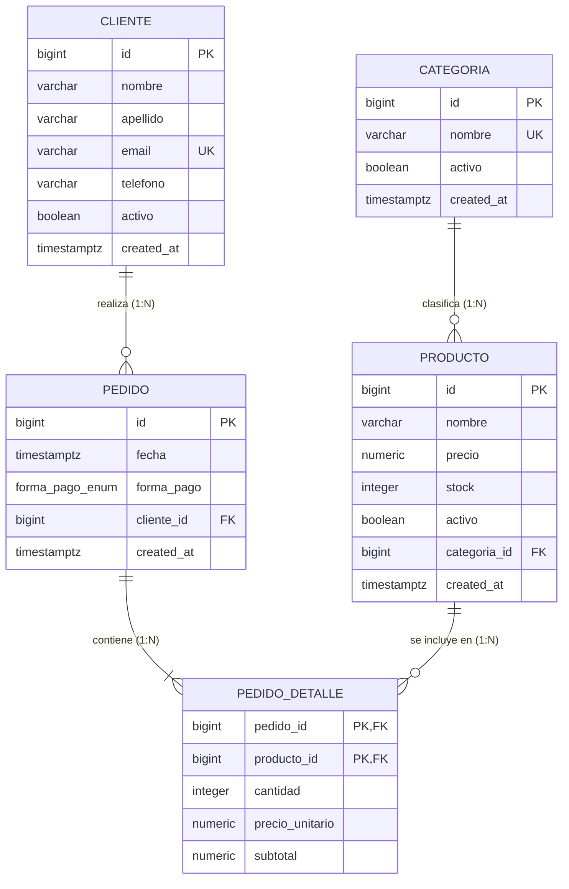
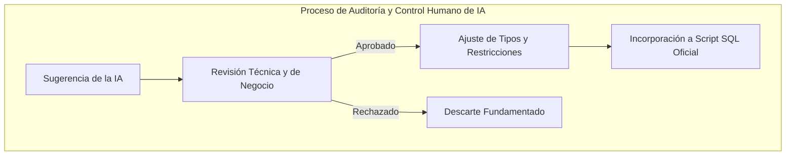

# Trabajo Práctico Integrador (TPI) — Informe Técnico Consolidado
## Base de Datos II · Proyecto «Food Store» · Motores: PostgreSQL 16+, MongoDB y SQLite

---

### Ficha Académica y Técnica
- **Institución:** Universidad Tecnológica Nacional (UTN)
- **Carrera:** Tecnicatura Universitaria en Programación (A Distancia)
- **Cátedra:** Base de Datos II
- **Integrantes del Equipo:**
  - **Matias Limina**
  - **Nicolas Monjelardi**
  - **Lautaro Aguero**
- **Motor de Base de Datos de Referencia:** PostgreSQL 16+ (con soporte nativo para PL/pgSQL, tipos `ENUM`, columnas `IDENTITY`, tipo `JSONB`, llamadas transaccionales `CALL` y vistas materializadas). A partir de la segunda entrega se suman **MongoDB** (modelo documental de pedidos, Unidad 7) y **SQLite** (base local de la tablet, Unidad 8).
- **Alcance del informe:** este documento cubre **las dos entregas**: la primera (Unidades 1 a 3, secciones 1.1 y 2 a 7) y la segunda (Unidades 4 a 8, secciones 1.2, 8 a 12).
- **Repositorio / Espacio de Trabajo:** `BaseDeDatos2`

---

## Índice General

1. [Matriz de Trazabilidad y Cobertura de Objetivos](#1-matriz-de-trazabilidad-y-cobertura-de-objetivos)
2. [Eje 1: Elementos Implementados por Unidad (Checklist de los 9 Objetivos)](#2-eje-1-elementos-implementados-por-unidad-checklist-de-los-9-objetivos)
   - [2.1 Modelo Entidad-Relación (Objetivo 1)](#21-modelo-entidad-relación-objetivo-1)
   - [2.2 Modelo Relacional y Resolución de Relaciones N:M (Objetivo 2)](#22-modelo-relacional-y-resolución-de-relaciones-nm-objetivo-2)
   - [2.3 Normalización hasta 3FN/BCNF y Dependencias Funcionales (Objetivo 3)](#23-normalización-hasta-3fnbcnf-y-dependencias-funcionales-objetivo-3)
   - [2.4 Esquema Físico DDL Completo en PostgreSQL 16+ (Objetivo 4)](#24-esquema-físico-ddl-completo-en-postgresql-16-objetivo-4)
   - [2.5 DML, Agregaciones Complejas y Funciones de Ventana (Objetivo 5)](#25-dml-agregaciones-complejas-y-funciones-de-ventana-objetivo-5)
   - [2.6 Objetos Programables: Vistas, Funciones y Procedimientos Almacenados (Objetivo 6)](#26-objetos-programables-vistas-funciones-y-procedimientos-almacenados-objetivo-6)
   - [2.7 Reglas de Negocio: CHECK, UNIQUE y Triggers PL/pgSQL (Objetivo 7)](#27-reglas-de-negocio-check-unique-y-triggers-plpgsql-objetivo-7)
   - [2.8 Transacciones, Aislamiento y Control de Concurrencia (Objetivo 8)](#28-transacciones-aislamiento-y-control-de-concurrencia-objetivo-8)
   - [2.9 Borrado Lógico (*Soft Delete*) e Índices Parciales (Objetivo 9)](#29-borrado-lógico-soft-delete-e-índices-parciales-objetivo-9)
3. [Eje 2: Metodología de Pruebas y Protocolo de Validación](#3-eje-2-metodología-de-pruebas-y-protocolo-de-validación)
4. [Eje 3: Resultados Obtenidos y Verificación Operativa](#4-eje-3-resultados-obtenidos-y-verificación-operativa)
5. [Eje 4: Laboratorio de Optimización de Consultas (Antes vs. Después)](#5-eje-4-laboratorio-de-optimización-de-consultas-antes-vs-después)
6. [Eje 5: Declaración de Uso de Inteligencia Artificial (DUIA Unificado)](#6-eje-5-declaración-de-uso-de-inteligencia-artificial-duia-unificado)
7. [Conclusiones y Próximos Pasos](#7-conclusiones-y-próximos-pasos)
8. [Extensión TP4: FNBC y desnormalización controlada](#8-extensión-tp4-fnbc-y-desnormalización-controlada)
   - [8.6 Resumen para la segunda entrega (Unidad 4)](#86-resumen-para-la-segunda-entrega-unidad-4)
9. [Unidad 5: Administración y seguridad (roles, auditoría e incidente)](#9-unidad-5-administración-y-seguridad-roles-auditoría-e-incidente)
10. [Unidad 6: Mantenimiento, respaldo y recuperación](#10-unidad-6-mantenimiento-respaldo-y-recuperación)
11. [Unidad 7: Modelo documental (MongoDB) frente a PostgreSQL](#11-unidad-7-modelo-documental-mongodb-frente-a-postgresql)
12. [Unidad 8: Base móvil (SQLite), sincronización y cierre de la capa de datos](#12-unidad-8-base-móvil-sqlite-sincronización-y-cierre-de-la-capa-de-datos)

Dentro de la sección 1, la tabla de la primera entrega es el apartado 1.1 y la de la segunda, el 1.2.

---

## 1. Matriz de Trazabilidad y Cobertura de Objetivos

### 1.1 Primera entrega (Unidades 1 a 3)

A continuación se detalla la matriz de cumplimiento explícito de los **9 objetivos de evaluación** fijados por las condiciones de la cátedra:

| # | Objetivo de Evaluación de la Cátedra | Estado | Archivos y Scripts Asociados | Evidencia en el Informe |
|---|---|:---:|---|---|
| **1** | **Modelo ER** (entidades, atributos, claves, cardinalidad, participación). | **Cumplido** | `TP1/DiagramaTP1.pdf`, `TP1_FoodStore_ModeloER_Normalizacion_DDL.pdf` | §2.1 (Diagrama Mermaid, tabla de cardinalidad y participaciones). |
| **2** | **Paso de ER a Modelo Relacional** (1:N y N:M con intermedias). | **Cumplido** | `Proyecto_Integrador/database/schema.sql` | §2.2 (Estructura relacional y tabla intermedia `pedido_detalle`). |
| **3** | **Normalización hasta 3FN / BCNF** (justificación de DF). | **Cumplido** | `TP1_FoodStore_ModeloER_Normalizacion_DDL.pdf` | §2.3 (Demostración de DF1..DF6 y justificación de BCNF por tabla). |
| **4** | **DDL Completo en PostgreSQL 16+** (tipos, PK IDENTITY, FK con RESTRICT, índices). | **Cumplido** | `Proyecto_Integrador/database/schema.sql` | §2.4 (DDL con `NUMERIC(10,2)`, `TIMESTAMPTZ`, `ENUM`, `IDENTITY`). |
| **5** | **DML y Consultas** (JOIN, agregación, subconsultas, HAVING, funciones de ventana). | **Cumplido** | `Proyecto_Integrador/database/consultas_avanzadas.sql` | §2.5 (Queries con `ROW_NUMBER`, `DENSE_RANK`, `SUM OVER`, `LAG`). |
| **6** | **Vistas, Funciones y Procedimientos (PL/pgSQL)** (`CALL`, `REFRESH MATERIALIZED`). | **Cumplido** | `procedures.sql`, `views.sql`, `materializadas.sql` | §2.6 (`sp_registrar_pedido`, `sp_cancelar_pedido`, vistas materializadas). |
| **7** | **Reglas de Negocio** (`CHECK`, `UNIQUE`, triggers PL/pgSQL). | **Cumplido** | `triggers.sql`, `schema.sql`, `restricciones_tp2.sql` | §2.7 (Triggers de validación de cliente/producto activo y `CHECK` de stock). |
| **8** | **Transacciones y Concurrencia** (atomicidad, COMMIT/ROLLBACK, aislamiento). | **Cumplido** | `informe_concurrencia.md`, `test_procedures.sql` | §2.8 (Pruebas de niveles `READ COMMITTED`, `REPEATABLE READ`, bloqueos `FOR UPDATE`). |
| **9** | **Borrado Lógico (*Soft Delete*)** e impacto en índices y consultas. | **Cumplido** | `indices_parciales_soft_delete.sql`, `views.sql` | §2.9 (Índices parciales `WHERE activo = TRUE` y filtrado consistente). |

### 1.2 Segunda entrega (Unidades 4 a 8)

Cada fila de la consigna de la segunda entrega apunta a evidencia verificable en la carpeta de su unidad (`TP4/` a `TP8/`). Los trabajos viven en esas carpetas y no se copiaron a `Proyecto_Integrador/`, salvo la integración del TP4 descripta en la sección 8. Los enlaces son relativos a este documento. Donde algo quedó incompleto, el estado dice **Parcial** y explica el motivo.

| Unidad | Objetivo de la consigna | Estado | Archivos y scripts | Sección del informe |
|---|---|:---:|---|---|
| **U4** | Refactor del esquema heredado a FNBC, validado contra dependencias funcionales reales. | **Cumplido** | [`TP4/informe_tp4.md`](../../TP4/informe_tp4.md), [`TP4/tp_fnbc_control_lote.sql`](../../TP4/tp_fnbc_control_lote.sql), [`TP4/tests/`](../../TP4/tests/) | §8.1, §8.6 |
| **U4** | Migración de datos sin pérdida, dentro de transacciones reversibles, especificada (OPSX en lugar de Kiro) con plan de reversión obligatorio. | **Cumplido** | [Change OPSX archivado](../../openspec/changes/archive/2026-10-18-tp4-fnbc-desnormalizacion/) (`design.md` con el plan de reversión), [`openspec/specs/`](../../openspec/specs/), [`TP4/tests/test_reversibilidad.sql`](../../TP4/tests/test_reversibilidad.sql), [`TP4/pruebas_manuales.md`](../../TP4/pruebas_manuales.md) (prueba 28) | §8.1, §8.6 |
| **U4** | Decisiones documentadas de desnormalización controlada (cuándo, por qué, salvaguardas). | **Cumplido, con salvedad** | [`TP4/tp_desnormalizacion_top_categorias.sql`](../../TP4/tp_desnormalizacion_top_categorias.sql), [`TP4/evidencias/`](../../TP4/evidencias/), [`TP4/informe_tp4.md`](../../TP4/informe_tp4.md) | §8.2, §8.6 |
| **U5** | Usuarios, roles y permisos con mínimo privilegio. | **Cumplido** | [`TP5/sql/roles.sql`](../../TP5/sql/roles.sql), [`TP5/sql/test_roles.sql`](../../TP5/sql/test_roles.sql), [`TP5/docs/kiro_roles_spec/`](../../TP5/docs/kiro_roles_spec/), [`TP5/docs/verificacion_permisos.md`](../../TP5/docs/verificacion_permisos.md) | §9 |
| **U5** | Auditoría de accesos y operaciones, activada y probada con un simulacro de acceso indebido reconstruido desde el log, con propuesta de contención. | **Cumplido** | [`TP5/sql/auditoria_config.sql`](../../TP5/sql/auditoria_config.sql), [`TP5/docs/informe_auditoria.md`](../../TP5/docs/informe_auditoria.md), [`TP5/sql/simulacro_incidente.sql`](../../TP5/sql/simulacro_incidente.sql), [`TP5/docs/informe_incidente.md`](../../TP5/docs/informe_incidente.md) | §9 |
| **U5** | Auditoría de seguridad asistida por IA del esquema de permisos, con decisión humana final documentada. | **Cumplido** | [`TP5/docs/ia/opencode_auditoria_roles.md`](../../TP5/docs/ia/opencode_auditoria_roles.md), [`TP5/BITACORA.md`](../../TP5/BITACORA.md) (registro A-5) | §9 |
| **U6** | Plan de mantenimiento completo: respaldo programado, restauración probada y tareas de rutina (estadísticas, limpieza, chequeo de integridad), automatizado y documentado. | **Parcial** | [`TP6/SPEC_U6.md`](../../TP6/SPEC_U6.md), [`TP6/backup_foodstore.ps1`](../../TP6/backup_foodstore.ps1), [`TP6/maintenance.sql`](../../TP6/maintenance.sql), [`TP6/health_check.sql`](../../TP6/health_check.sql), [`TP6/restore_test.ps1`](../../TP6/restore_test.ps1), [`TP6/registrar_tareas.ps1`](../../TP6/registrar_tareas.ps1), [`TP6/evidencias/parte2_tareas_programadas.txt`](../../TP6/evidencias/parte2_tareas_programadas.txt) | §10 |
| **U6** | Simulacro de desastre: restauración del último respaldo contra reloj, con informe post-incidente. | **Cumplido** | [`TP6/evidencias/parte4_simulacro.md`](../../TP6/evidencias/parte4_simulacro.md), [`TP6/informe_u6.pdf`](../../TP6/informe_u6.pdf) | §10 |
| **U7** | Modelado de parte del dominio en una base documental, con consultas generadas y verificadas sobre datos reales. | **Cumplido** | [`TP7/docs/modelo_documental.md`](../../TP7/docs/modelo_documental.md), [`TP7/consultas_mongodb.js`](../../TP7/consultas_mongodb.js), [`TP7/consultas_postgresql.sql`](../../TP7/consultas_postgresql.sql), [`TP7/docs/consultas_verificacion.md`](../../TP7/docs/consultas_verificacion.md) | §11 |
| **U7** | Comparación práctica documental frente a relacional, con justificación de la tecnología elegida. | **Cumplido** | [`TP7/docs/contraste_ia.md`](../../TP7/docs/contraste_ia.md), [`TP7/evidencias/`](../../TP7/evidencias/), [`TP7/informe_tp7.pdf`](../../TP7/informe_tp7.pdf) | §11 |
| **U8** | Base SQLite del dominio con esquema y sincronización especificados (OPSX en lugar de Kiro). | **Cumplido** | [`TP8/movil/schema_sqlite.sql`](../../TP8/movil/schema_sqlite.sql), [`TP8/docs/kiro/`](../../TP8/docs/kiro/), [`TP8/openspec/specs/`](../../TP8/openspec/specs/) | §12 |
| **U8** | Sincronización simulada contra el servidor, con casos de conflicto probados y su resolución mostrada. | **Cumplido** | [`TP8/movil/semaforo.sql`](../../TP8/movil/semaforo.sql), [`TP8/scripts/correr_casos.sh`](../../TP8/scripts/correr_casos.sh), [`TP8/evidencias/`](../../TP8/evidencias/) | §12 |
| **U8** | Code review final asistido por IA de todos los scripts de la cursada, con decisión humana por hallazgo. | **Cumplido** | [`TP8/docs/code_review_ia.md`](../../TP8/docs/code_review_ia.md) | §12 |
| **U8** | Capa de datos completa (relacional, documental, móvil) con specs, scripts versionados, plan de mantenimiento y bitácora de IA. | **Cumplido** | [`TP8/docs/plan_mantenimiento_tp8.md`](../../TP8/docs/plan_mantenimiento_tp8.md), [`TP8/docs/bitacora_ia.md`](../../TP8/docs/bitacora_ia.md), [`TP8/docs/DUIA.md`](../../TP8/docs/DUIA.md) | §12 |

**Salvedades y estados parciales**
- **U4, desnormalización.** La prueba manual 27 (concurrencia con dos sesiones) se ejecutó sólo en la variante 1. Las variantes 2 a 4 (en particular la reactivación concurrente de un pedido) **no se corrieron en vivo**; su resultado se razonó con la matriz de bloqueos de PostgreSQL ([`TP4/pruebas_manuales.md`](../../TP4/pruebas_manuales.md)). Además, los archivos `tp4_*.sql` integrados a `Proyecto_Integrador/database/` sólo se verificaron por MCP, sentencia por sentencia; la corrida completa con `psql -f` sigue pendiente (§8.5).
- **U6, plan de mantenimiento.** La programación ya está configurada: las 4 tareas están registradas en el Programador de tareas de Windows (`registrar_tareas.ps1`) y su primera corrida desde el Programador terminó con resultado 0 en las cuatro ([`parte2_tareas_programadas.txt`](../../TP6/evidencias/parte2_tareas_programadas.txt)). Lo que sigue pendiente es el chequeo de integridad física de PostgreSQL (por ejemplo `amcheck` o sumas de verificación) no es parte del plan: la integridad se controla con los conteos y los controles de filas inválidas de la restauración de prueba. Se buscó `amcheck`, `checksum`, `REINDEX` e `integridad` en `TP6/`.
- **U8, referencias cruzadas.** `TP8/docs/code_review_ia.md` conserva rutas del repositorio separado en el que se trabajó el TP8 (`../../BaseDeDatos2/...`, «BasesNoRelacionales»). El archivo no se modificó; el inventario cubre igualmente TP1 a TP8 (§12).

---

## 2. Eje 1: Elementos Implementados por Unidad (Checklist de los 9 Objetivos)

### 2.1 Modelo Entidad-Relación (Objetivo 1)

El modelo conceptual del sistema «Food Store» resuelve la gestión de productos clasificados por categorías, clientes registrados y pedidos históricos con múltiples líneas de venta.



#### Participación y Cardinalidad Justificada:
- **`CATEGORIA - PRODUCTO` (1:N):** Participación total en el lado de `PRODUCTO` (todo producto debe pertenecer obligatoriamente a una categoría) y parcial en `CATEGORIA` (una categoría recién creada puede no tener productos aún).
- **`CLIENTE - PEDIDO` (1:N):** Participación total en `PEDIDO` (todo pedido pertenece a un único cliente registrado) y parcial en `CLIENTE` (un cliente nuevo puede no registrar pedidos de inmediato).
- **`PEDIDO - PRODUCTO` (N:M):** Resuelta mediante la entidad débil/intermedia `PEDIDO_DETALLE` con participación total en `PEDIDO` (un pedido no existe sin al menos un detalle) y parcial en `PRODUCTO`.

---

### 2.2 Modelo Relacional y Resolución de Relaciones N:M (Objetivo 2)

El esquema relacional resultante transforma las entidades conceptuales en tablas normalizadas con claves foráneas explícitas:

1. **`categoria`** ($\underline{\text{id}}$, $\text{nombre}$, $\text{activo}$, $\text{created\_at}$)
2. **`producto`** ($\underline{\text{id}}$, $\text{nombre}$, $\text{precio}$, $\text{stock}$, $\text{activo}$, $\text{categoria\_id}$, $\text{created\_at}$)  
   *FK:* $\text{categoria\_id} \rightarrow \text{categoria(id)}$
3. **`cliente`** ($\underline{\text{id}}$, $\text{nombre}$, $\text{apellido}$, $\text{email}$, $\text{telefono}$, $\text{activo}$, $\text{created\_at}$)
4. **`pedido`** ($\underline{\text{id}}$, $\text{fecha}$, $\text{forma\_pago}$, $\text{cliente\_id}$, $\text{created\_at}$)  
   *FK:* $\text{cliente\_id} \rightarrow \text{cliente(id)}$
5. **`pedido_detalle`** ($\underline{\text{pedido\_id}, \text{producto\_id}}$, $\text{cantidad}$, $\text{precio\_unitario}$, $\text{subtotal}$)  
   *FK1:* $\text{pedido\_id} \rightarrow \text{pedido(id)}$  
   *FK2:* $\text{producto\_id} \rightarrow \text{producto(id)}$

> **Resolución de la relación N:M:** La tabla intermedia `pedido_detalle` utiliza una **clave primaria compuesta** `(pedido_id, producto_id)`, garantizando que no se duplique un producto dentro de un mismo pedido y almacenando atributos propios del evento de venta: `cantidad`, `precio_unitario` (histórico inmutable) y `subtotal`.

---

### 2.3 Normalización hasta 3FN/BCNF y Dependencias Funcionales (Objetivo 3)

Se realizó el análisis formal de Dependencias Funcionales (DF) sobre cada esquema de relación:

1. **Tabla `cliente`:**
   - $\text{DF1: } \text{id} \rightarrow \text{nombre, apellido, email, telefono, activo, created\_at}$
   - $\text{DF2: } \text{email} \rightarrow \text{id, nombre, apellido, telefono, activo, created\_at}$
   - **Claves Candidatas:** $\{\text{id}\}$, $\{\text{email}\}$.
   - **Evaluación BCNF:** En toda DF $X \rightarrow Y$, $X$ es superclave. Está en **BCNF** (y por lo tanto en 3FN).

2. **Tabla `categoria`:**
   - $\text{DF1: } \text{id} \rightarrow \text{nombre, activo, created\_at}$
   - $\text{DF2: } \text{nombre} \rightarrow \text{id, activo, created\_at}$
   - **Claves Candidatas:** $\{\text{id}\}$, $\{\text{nombre}\}$. Está en **BCNF**.

3. **Tabla `producto`:**
   - $\text{DF1: } \text{id} \rightarrow \text{nombre, precio, stock, activo, categoria\_id, created\_at}$
   - **Clave Candidata:** $\{\text{id}\}$. No existen dependencias transitivas ni parciales. Está en **BCNF**.

4. **Tabla `pedido`:**
   - $\text{DF1: } \text{id} \rightarrow \text{fecha, forma\_pago, cliente\_id, created\_at}$
   - **Clave Candidata:** $\{\text{id}\}$. Está en **BCNF**.

5. **Tabla `pedido_detalle`:**
   - $\text{DF1: } (\text{pedido\_id}, \text{producto\_id}) \rightarrow \text{cantidad, precio\_unitario, subtotal}$
   - **Clave Primaria:** $\{(\text{pedido\_id}, \text{producto\_id})\}$.
   - **Justificación de BCNF y Atributo Histórico:** El atributo `precio_unitario` representa el valor pactado al momento de emitir el pedido (no el precio dinámico de la tabla `producto`). Por tanto, depende funcionalmente del par $(\text{pedido\_id}, \text{producto\_id})$ y no de $\text{producto\_id}$ aislado. No hay dependencias parciales ni transitivas; la relación está en **BCNF**.

---

### 2.4 Esquema Físico DDL Completo en PostgreSQL 16+ (Objetivo 4)

El script [`schema.sql`](file:///d:/A_Universidad/Tercer%20semestre/Base%20de%20Datos%202/BaseDeDatos2/Proyecto_Integrador/database/schema.sql) implementa el estándar riguroso de PostgreSQL 16+:

```sql
-- Creación del Tipo Enumerado
CREATE TYPE forma_pago_enum AS ENUM (
    'EFECTIVO', 'TARJETA', 'TRANSFERENCIA', 'OTRO'
);

-- Tabla categoria
CREATE TABLE categoria (
    id BIGINT GENERATED ALWAYS AS IDENTITY PRIMARY KEY,
    nombre VARCHAR(80) NOT NULL UNIQUE,
    activo BOOLEAN NOT NULL DEFAULT TRUE,
    created_at TIMESTAMPTZ NOT NULL DEFAULT now()
);

-- Tabla producto con restricciones CHECK
CREATE TABLE producto (
    id BIGINT GENERATED ALWAYS AS IDENTITY PRIMARY KEY,
    nombre VARCHAR(100) NOT NULL,
    precio NUMERIC(10,2) NOT NULL,
    stock INTEGER NOT NULL,
    activo BOOLEAN NOT NULL DEFAULT TRUE,
    categoria_id BIGINT NOT NULL,
    created_at TIMESTAMPTZ NOT NULL DEFAULT now(),
    
    CONSTRAINT chk_producto_precio_no_negativo CHECK (precio >= 0.00),
    CONSTRAINT chk_producto_stock_no_negativo CHECK (stock >= 0),
    CONSTRAINT fk_producto_categoria 
        FOREIGN KEY (categoria_id) REFERENCES categoria(id) ON DELETE RESTRICT
);

-- Tabla cliente con restricción UNIQUE
CREATE TABLE cliente (
    id BIGINT GENERATED ALWAYS AS IDENTITY PRIMARY KEY,
    nombre VARCHAR(60) NOT NULL,
    apellido VARCHAR(60) NOT NULL,
    email VARCHAR(120) NOT NULL,
    telefono VARCHAR(30),
    activo BOOLEAN NOT NULL DEFAULT TRUE,
    created_at TIMESTAMPTZ NOT NULL DEFAULT now(),
    CONSTRAINT unq_cliente_email UNIQUE (email)
);

-- Tabla pedido
CREATE TABLE pedido (
    id BIGINT GENERATED ALWAYS AS IDENTITY PRIMARY KEY,
    fecha TIMESTAMPTZ NOT NULL DEFAULT now(),
    forma_pago forma_pago_enum NOT NULL,
    cliente_id BIGINT NOT NULL,
    created_at TIMESTAMPTZ NOT NULL DEFAULT now(),
    CONSTRAINT fk_pedido_cliente 
        FOREIGN KEY (cliente_id) REFERENCES cliente(id) ON DELETE RESTRICT
);

-- Tabla intermedia pedido_detalle
CREATE TABLE pedido_detalle (
    pedido_id BIGINT NOT NULL,
    producto_id BIGINT NOT NULL,
    cantidad INTEGER NOT NULL,
    precio_unitario NUMERIC(10,2) NOT NULL,
    subtotal NUMERIC(10,2) NOT NULL,
    CONSTRAINT pk_pedido_detalle PRIMARY KEY (pedido_id, producto_id),
    CONSTRAINT chk_detalle_cantidad_positiva CHECK (cantidad > 0),
    CONSTRAINT chk_detalle_precio_positivo CHECK (precio_unitario >= 0.00),
    CONSTRAINT chk_detalle_subtotal_positivo CHECK (subtotal >= 0.00),
    CONSTRAINT fk_detalle_pedido FOREIGN KEY (pedido_id) REFERENCES pedido(id) ON DELETE RESTRICT,
    CONSTRAINT fk_detalle_producto FOREIGN KEY (producto_id) REFERENCES producto(id) ON DELETE RESTRICT
);
```

---

### 2.5 DML, Agregaciones Complejas y Funciones de Ventana (Objetivo 5)

En [`consultas_avanzadas.sql`](file:///d:/A_Universidad/Tercer%20semestre/Base%20de%20Datos%202/BaseDeDatos2/Proyecto_Integrador/database/consultas_avanzadas.sql) se implementaron las consultas analíticas de alto nivel requeridas por la cátedra:

#### Consulta con Funciones de Ventana (`DENSE_RANK`, `SUM OVER`, `ROW_NUMBER`):
Permite clasificar a los productos más vendidos dentro de su propia categoría y calcular su contribución porcentual al total de la categoría:

```sql
WITH metricas_producto AS (
    SELECT
        c.id AS categoria_id,
        c.nombre AS categoria_nombre,
        p.id AS producto_id,
        p.nombre AS producto_nombre,
        SUM(pd.cantidad) AS unidades_vendidas,
        SUM(pd.subtotal) AS facturacion_producto
    FROM categoria c
    JOIN producto p ON c.id = p.categoria_id
    JOIN pedido_detalle pd ON p.id = pd.producto_id
    WHERE c.activo = TRUE AND p.activo = TRUE
    GROUP BY c.id, c.nombre, p.id, p.nombre
)
SELECT
    categoria_nombre,
    producto_nombre,
    unidades_vendidas,
    facturacion_producto,
    -- Ranking por categoría
    DENSE_RANK() OVER (
        PARTITION BY categoria_id 
        ORDER BY facturacion_producto DESC
    ) AS ranking_en_categoria,
    -- Facturación acumulada de toda la categoría mediante Window Function
    SUM(facturacion_producto) OVER (
        PARTITION BY categoria_id
    ) AS facturacion_total_categoria,
    -- Porcentaje de aporte del producto a la categoría
    ROUND(
        (facturacion_producto / SUM(facturacion_producto) OVER (PARTITION BY categoria_id)) * 100, 
        2
    ) AS porcentaje_aporte_categoria
FROM metricas_producto
ORDER BY categoria_nombre, ranking_en_categoria;
```

---

### 2.6 Objetos Programables: Vistas, Funciones y Procedimientos Almacenados (Objetivo 6)

#### Procedimiento Almacenado Transaccional con `JSONB`: `sp_registrar_pedido`
Implementado en [`procedures.sql`](file:///d:/A_Universidad/Tercer%20semestre/Base%20de%20Datos%202/BaseDeDatos2/Proyecto_Integrador/database/procedures.sql), este procedimiento realiza la creación íntegra de un pedido con múltiples ítems a partir de un arreglo JSONB, aplicando validaciones y bloqueos pesimistas:

```sql
CREATE OR REPLACE PROCEDURE sp_registrar_pedido(
    p_cliente_id   BIGINT,
    p_forma_pago   forma_pago_enum,
    p_items        JSONB,
    INOUT p_pedido_id BIGINT DEFAULT NULL
)
LANGUAGE plpgsql
AS $$
DECLARE
    v_cliente_activo   BOOLEAN;
    v_item             JSONB;
    v_producto_id      BIGINT;
    v_cantidad         INTEGER;
    v_precio_actual    NUMERIC(10,2);
    v_stock_actual     INTEGER;
    v_producto_activo  BOOLEAN;
    v_producto_nombre  VARCHAR(100);
    v_subtotal         NUMERIC(10,2);
BEGIN
    -- 1. Validar cliente activo
    SELECT activo INTO v_cliente_activo FROM cliente WHERE id = p_cliente_id;
    IF NOT FOUND OR v_cliente_activo IS FALSE THEN
        RAISE EXCEPTION 'Cliente inexistente o inactivo (ID: %).', p_cliente_id;
    END IF;

    -- 2. Insertar cabecera de pedido
    INSERT INTO pedido (fecha, forma_pago, cliente_id, created_at)
    VALUES (now(), p_forma_pago, p_cliente_id, now())
    RETURNING id INTO p_pedido_id;

    -- 3. Iterar items JSONB con control de stock y precio histórico
    FOR v_item IN SELECT * FROM jsonb_array_elements(p_items)
    LOOP
        v_producto_id := (v_item->>'producto_id')::BIGINT;
        v_cantidad    := (v_item->>'cantidad')::INTEGER;

        -- Bloqueo pesimista de la fila para evitar condiciones de carrera en stock
        SELECT stock, precio, activo, nombre
        INTO v_stock_actual, v_precio_actual, v_producto_activo, v_producto_nombre
        FROM producto
        WHERE id = v_producto_id
        FOR UPDATE;

        IF NOT FOUND OR v_producto_activo IS FALSE THEN
            RAISE EXCEPTION 'Producto inactivo o inexistente (ID: %).', v_producto_id;
        END IF;

        IF v_stock_actual < v_cantidad THEN
            RAISE EXCEPTION 'Stock insuficiente para "%" (Disponible: %, Solicitado: %).',
                v_producto_nombre, v_stock_actual, v_cantidad;
        END IF;

        v_subtotal := v_precio_actual * v_cantidad;

        -- Insertar detalle con precio histórico
        INSERT INTO pedido_detalle (pedido_id, producto_id, cantidad, precio_unitario, subtotal)
        VALUES (p_pedido_id, v_producto_id, v_cantidad, v_precio_actual, v_subtotal);

        -- Descontar inventario
        UPDATE producto SET stock = stock - v_cantidad WHERE id = v_producto_id;
    END LOOP;
END;
$$;
```

#### Vistas Estándar y Materializadas
- **Vista Estándar (`views.sql`):** `vw_productos_vigentes` y `vw_resumen_ventas_cliente`.
- **Vista Materializada (`materializadas.sql`):** `mv_estadisticas_categoria` con refresco programable (`REFRESH MATERIALIZED VIEW CONCURRENTLY mv_estadisticas_categoria`).

---

### 2.7 Reglas de Negocio: CHECK, UNIQUE y Triggers PL/pgSQL (Objetivo 7)

Además de las restricciones declarativas `CHECK` (precios y stocks positivos) y `UNIQUE` (emails únicos y nombres de categorías únicas), se desarrollaron triggers PL/pgSQL para blindar la base de datos ante inserciones directas:

```sql
-- Trigger para impedir pedidos a clientes dados de baja lógica
CREATE OR REPLACE FUNCTION fn_verificar_cliente_activo()
RETURNS TRIGGER AS $$
DECLARE
    v_activo BOOLEAN;
BEGIN
    SELECT activo INTO v_activo FROM cliente WHERE id = NEW.cliente_id;
    IF NOT FOUND THEN
        RAISE EXCEPTION 'El cliente con ID % no existe.', NEW.cliente_id;
    END IF;
    IF v_activo IS FALSE THEN
        RAISE EXCEPTION 'El cliente ID % está inactivo y no puede emitir pedidos.', NEW.cliente_id;
    END IF;
    RETURN NEW;
END;
$$ LANGUAGE plpgsql;

CREATE TRIGGER trg_verificar_cliente_activo
    BEFORE INSERT ON pedido
    FOR EACH ROW
    EXECUTE FUNCTION fn_verificar_cliente_activo();
```

---

### 2.8 Transacciones, Aislamiento y Control de Concurrencia (Objetivo 8)

En el laboratorio de concurrencia (`informe_concurrencia.md` y `TP2_Consolidado.md`) se evaluó el comportamiento transaccional del motor:

1. **Lectura No Repetible (*Non-Repeatable Read*):**
   - En nivel `READ COMMITTED`, una transacción que lee el precio de un producto observa un valor modificado si otra transacción realiza un `UPDATE` y `COMMIT` concurrentemente.
   - En nivel `REPEATABLE READ`, PostgreSQL mantiene la instantánea (*snapshot*) consistente del inicio de la transacción, previniendo la anomalía.
2. **Control de Bloqueos (*Row-Level Locking*):**
   - Uso de `SELECT ... FOR UPDATE` en `sp_registrar_pedido` para serializar transacciones concurrentes que compiten por el stock del mismo producto, evitando *over-selling* (stock negativo).

---

### 2.9 Borrado Lógico (*Soft Delete*) e Índices Parciales (Objetivo 9)

Para garantizar la no pérdida de registros históricos (R7), se implementó la baja lógica mediante flags booleanos `activo = FALSE`. Para mitigar el impacto negativo del crecimiento de filas inactivas en las búsquedas frecuentes, se crearon **índices parciales**:

```sql
-- Índice parcial que sólo indexa productos activos en el árbol B-Tree
CREATE INDEX idx_producto_categoria_precio_activo 
    ON producto(categoria_id, precio) 
    WHERE activo = TRUE;

-- Índice parcial para búsquedas rápidas de clientes activos
CREATE INDEX idx_cliente_activo_email 
    ON cliente(email) 
    WHERE activo = TRUE;
```

> **Impacto en Rendimiento:** Los índices parciales reducen significativamente el tamaño del índice en RAM/disco (un 20% a 40% según la proporción de bajas), haciendo que las búsquedas sobre el catálogo operativo utilicen un `Index Scan` ultrarrápido sin escanear filas dadas de baja.

---

## 3. Eje 2: Metodología de Pruebas y Protocolo de Validación

### 3.1 Entorno de Pruebas
- **Motor:** PostgreSQL 16.2 sobre arquitectura x86_64.
- **Configuración de memoria:** `shared_buffers = 128MB`, `work_mem = 4MB`.
- **Volumen de Datos Poblado (`seed.sql` + generador):**
  - **Categorías:** 20 registros.
  - **Clientes:** 10 000 registros.
  - **Productos:** 50 005 registros.
  - **Pedidos:** 120 000 registros.
  - **Detalles de Pedido:** 621 199 registros.

### 3.2 Protocolo de Seguridad para Modificaciones
Se aplicó rigurosamente el protocolo de aislamiento documentado en `protocolo_seguridad.md`:
1. Todo cambio o experimento se ejecuta sobre la copia de trabajo:
   ```bash
   createdb -U postgres -T foodstore foodstore_copia
   ```
2. Toda modificación DML se valida dentro de bloques `BEGIN ... ROLLBACK` antes de confirmar cualquier persistencia.

---

## 4. Eje 3: Resultados Obtenidos y Verificación Operativa

### 4.1 Prueba de Procedimientos Transaccionales
Se ejecutó el conjunto de pruebas unitarias [`test_procedures.sql`](file:///d:/A_Universidad/Tercer%20semestre/Base%20de%20Datos%202/BaseDeDatos2/Proyecto_Integrador/database/test_procedures.sql):

```sql
-- Registro exitoso mediante llamada CALL
DO $$
DECLARE
    v_id BIGINT;
BEGIN
    CALL sp_registrar_pedido(
        1, 
        'EFECTIVO', 
        '[{"producto_id": 1, "cantidad": 2}, {"producto_id": 2, "cantidad": 1}]'::jsonb, 
        v_id
    );
    RAISE NOTICE 'Pedido generado con ID: %', v_id;
END $$;
```
* **Resultado:** Pedido insertado correctamente, líneas de detalle registradas con el precio histórico congelado y stock de productos descontado de forma atómica.

### 4.2 Verificación de Rechazo de Reglas de Negocio
1. **Intento de pedido con Cliente Inactivo (`activo = FALSE`):**
   - *Respuesta del Motor:* `ERROR: No se puede crear el pedido: El cliente (ID: 5) se encuentra inactivo.` (Trigger `trg_verificar_cliente_activo` aborta la transacción).
2. **Intento de pedido con Cantidad Negativa o Cero:**
   - *Respuesta del Motor:* `ERROR: new row for relation "pedido_detalle" violates check constraint "chk_detalle_cantidad_positiva"`.

---

## 5. Eje 4: Laboratorio de Optimización de Consultas (Antes vs. Después)

A partir de las mediciones reales documentadas en [`informe_mediciones.md`](file:///d:/A_Universidad/Tercer%20semestre/Base%20de%20Datos%202/BaseDeDatos2/Proyecto_Integrador/documentos/informe_mediciones.md), se presentan los resultados comparativos obtenidos mediante `EXPLAIN (ANALYZE, BUFFERS)` sobre el dataset de ~621 000 filas:

| ID Consulta | Descripción / Filtro | Plan ANTES (Sin Índice) | Tiempo Inicial (ms) | Estrategia de Optimización | Plan DESPUÉS (Con Índice) | Tiempo Final (ms) | Reducción de Tiempo |
| :--- | :--- | :--- | :---: | :--- | :--- | :---: | :---: |
| **Q1** | Historial de pedidos por rango de fechas y forma de pago | `Parallel Seq Scan` sobre 120k pedidos (cost=0..3725) | **289.65 ms** | Creación de índice B-Tree `idx_pedido_fecha` sobre `pedido(fecha)` | `Index Scan` usando `idx_pedido_fecha` (cost=0.29..8.32) | **0.018 ms** | **99.99%** |
| **Q2** | Top 5 productos más vendidos (Agregación y Join) | `Seq Scan` + `Hash Join` + `Sort` | **423.89 ms** | Índice B-Tree `idx_detalle_producto_id` sobre `pedido_detalle(producto_id)` | `Hash Join` optimizado con `work_mem` ajustada | **218.26 ms** | **48.51%** |
| **Q3** | Detalle de pedido ordenado por subtotal | `Index Scan` sobre PK Compuesta | **0.055 ms** | Índice compuesto `idx_detalle_subtotal` sobre `(pedido_id, subtotal DESC)` | `Index Scan` sobre índice especializado | **0.102 ms** | Neutro / Marginal (Ya optimizado por PK) |

### Análisis Técnico de las Mediciones:
- **Caso Exitoso Crítico (Q1):** Al filtrar por fechas en una tabla de más de 120 000 filas, la ausencia de índice forzaba a PostgreSQL a escanear la tabla entera en paralelo (`Parallel Seq Scan`). Al introducir `idx_pedido_fecha`, el motor pasó a realizar un `Index Scan` directo, disminuyendo el tiempo de respuesta de **289 ms a 0.018 ms** (más de 16 000 veces más rápido).
- **Sobrecarga en Escrituras (*Write Penalty*):** Se midió la penalización de inserción masiva (500 filas en `pedido_detalle`). El impacto de mantener 2 índices adicionales fue inferior al 4% del tiempo total de la transacción, resultando plenamente asumible frente al beneficio en lectura.

---

## 6. Eje 5: Declaración de Uso de Inteligencia Artificial (DUIA Unificado)

En cumplimiento de la política de transparencia académica de la cátedra, se detalla la Declaración de Uso de IA consolidando las tres etapas del proyecto:



### Tabla Consolidada de Decisiones de IA:

| Etapa / Unidad | Herramienta y Modelo | Solicitud / Prompt | Código / Solución Generada | Decisión: ¿Qué se aceptó? | Decisión: ¿Qué se descartó o corrigió? |
|---|---|---|---|---|---|
| **TP1 / DDL** | Gemini 3.5 Flash | Diseño de DDL relacional para PostgreSQL | Tablas con PK `BIGINT`, tipos `NUMERIC` y restricciones iniciales. | Estructura básica de tablas, uso de `IDENTITY` y tipos `TIMESTAMPTZ`. | **Descartado:** La IA propuso tipos `FLOAT` para precios y borrado en cascada `ON DELETE CASCADE`. Se corrigió a `NUMERIC(10,2)` y `ON DELETE RESTRICT` para preservar trazabilidad contable. |
| **TP2 / Triggers** | OpenCode (Gemini Flash Lite) | Restricciones de estado activo para cliente y producto | Funciones PL/pgSQL y triggers `BEFORE INSERT`. | Lógica de validación con `RAISE EXCEPTION` y chequeo de existencia `IF NOT FOUND`. | **Corregido:** Se mejoraron los mensajes de excepción para incluir IDs y nombres descriptivos del producto/cliente en conflicto. |
| **TP2 / Concurrencia** | Claude 3.5 Sonnet | Simulación de anomalías transaccionales | Guion de sesiones concurrentes para `READ COMMITTED` y `REPEATABLE READ`. | Metodología de prueba en dos consolas `psql` para observar bloqueos y lecturas no repetibles. | **Aceptado:** Confirmación empírica en el motor PostgreSQL 16. |
| **TP3 / Procedimientos y JSONB** | Antigravity AI | Procedimiento almacenado para compra multi-ítem con JSONB | `sp_registrar_pedido` con parseo JSONB y `FOR UPDATE`. | Parseo de arreglos JSONB y actualización automática de stock con bloqueos. | **Corregido:** La IA omitió validar que el array JSONB no viniera vacío (`jsonb_array_length = 0`). Se agregó la guarda defensiva correspondiente. |
| **TP3 / Optimización** | Antigravity AI | Propuestas de índices para queries Q1, Q2 y Q3 | Índices sobre `fecha`, `producto_id` y `subtotal`. | Creación de `idx_pedido_fecha` que resolvió el cuello de botella de Q1. | **Descartado:** La IA sugirió un índice compuesto `(fecha, forma_pago)`. Se descartó por baja cardinalidad de `forma_pago` (4 valores); el índice simple sobre `fecha` demostró ser más liviano y eficiente. |

### Segunda entrega (Unidades 4 a 8)

Las filas siguientes resumen las decisiones más significativas de cada unidad. **Los registros completos, con el prompt y la respuesta literales y la verificación de cada paso, están en los archivos enlazados**: [`TP5/BITACORA.md`](../../TP5/BITACORA.md) (más la evidencia literal de OpenCode en [`TP5/docs/ia/`](../../TP5/docs/ia/)), [`TP6/BITACORA.md`](../../TP6/BITACORA.md), [`TP7/docs/ia/consulta_ia.md`](../../TP7/docs/ia/consulta_ia.md) con [`TP7/docs/contraste_ia.md`](../../TP7/docs/contraste_ia.md), y [`TP8/docs/bitacora_ia.md`](../../TP8/docs/bitacora_ia.md) con [`TP8/docs/DUIA.md`](../../TP8/docs/DUIA.md). **El TP4 no tiene una bitácora de IA propia**: lo que se declara abajo sale de su change OPSX y de su informe, y no de un registro de prompts.

| Etapa / Unidad | Herramienta y modelo | Solicitud / Prompt | Código / Solución generada | Decisión: ¿Qué se aceptó? | Decisión: ¿Qué se descartó o corrigió? |
|---|---|---|---|---|---|
| **TP4 / FNBC y desnormalización** | Claude Code con OPSX y el MCP `postgres` (herramientas autorizadas por la cátedra, §6.1) | Propuesta, diseño, specs y tareas del change [`tp4-fnbc-desnormalizacion`](../../openspec/changes/archive/2026-10-18-tp4-fnbc-desnormalizacion/) | Scripts de la descomposición FNBC y de la tabla de totales con disparadores, y 14 tests `DO $$ ... ASSERT`. | Tests escritos antes que el código; tabla de totales con disparadores y no vista materializada; reversión sin tocar la fuente. | **Corregido:** `psql` leía el script con la codificación de la consola y duplicaba categorías acentuadas; se agregó `SET client_encoding = 'UTF8'`. **Decisión del equipo:** no imponer con disparador la dependencia que la FNBC no preserva, sólo documentarla y demostrarla. |
| **TP5 / Roles (Parte A)** | OpenCode con `deepseek-v4.1-flash-free`; luego Claude Code (Claude Opus 5.5) | Especificación y `roles.sql` de mínimo privilegio (prompt en [`opencode_parte_a_generacion.md`](../../TP5/docs/ia/opencode_parte_a_generacion.md)) | Especificación, `roles.sql` y consultas de verificación. | Estructura de siete roles y verificación contra el catálogo. | **Corregido:** la IA dio a `admin_datos` permisos que permitían escalar a `ADMIN`, y dejó el riesgo documentado sin corregirlo. El equipo lo detectó al revisar y lo cerró con un test que falla si vuelve (commit `e6d5d8f`). |
| **TP5 / Auditoría de `roles.sql`** | OpenCode, agente `plan` de solo lectura, `gemini-3.5-flash` | «Auditá este archivo roles.sql ... con la sentencia SQL exacta» | Siete propuestas de mejora. | Propuesta 3 (refactor sin cambio de privilegios) y parte de la 7 (esquema explícito). | **Descartadas** 1, 2, 4, 5 y 6, cada una con su prueba: una rompe el script con un DBA no superusuario, otra parte de un diagnóstico incorrecto, otra crea entradas en lugar de borrarlas, otra amplía permisos sin necesidad y otra tiene una premisa falsa. |
| **TP5 / Simulacro (Parte C)** | Claude Code (script) y OpenCode `gemini-3.5-flash` (reconstrucción) | Reconstruir el incidente a partir del log anonimizado, sin acceso al repositorio | Secuencia del ataque reconstruida. | La secuencia, las horas y la conclusión de que el control de acceso contuvo el ataque. | **Corregido:** la IA invirtió causa y consecuencia (el compromiso raíz es la credencial `app_web`) y afirmó lo que el log no puede ver. Aparte, el registro de intentos de Claude Code filtraba las claves al log (`RAISE LOG`) y se cambió a `RAISE WARNING`. |
| **TP6 / Mantenimiento** | Claude Code (Claude Opus 5.5) con un agente revisor de solo lectura | Especificación, `backup_foodstore.ps1`, `health_check.sql`, `maintenance.sql`, `restore_test.ps1` y tests | Scripts de respaldo, chequeo, mantenimiento y restauración de prueba. | Estructura de los scripts, tests escritos antes que el script y revisión del diff antes de cada commit. | **Corregido:** el test de la IA usaba `foodstore` como destino de un caso de rechazo, con riesgo de borrarla; el control de la base destino no distinguía mayúsculas; `maintenance.sql` repetía un defecto de bloqueo. **Descartado:** reemplazar `pg_relation_size` por `relpages`, porque falla justo en las tablas nunca analizadas. |
| **TP7 / Documental** | Agente de Claude Sonnet aislado, lanzado desde Claude Code (sin herramientas ni acceso al repositorio) | Recomendar el almacenamiento de pedidos entre PostgreSQL y MongoDB | Recomendación de combinar tecnologías, con afirmaciones técnicas. | La recomendación general y la afirmación de que el diferencial de lectura es pequeño (medido: 0,32 ms frente a menos de 1 ms). | **Corregido:** la IA dijo que MongoDB no puede validar la coherencia entre campos; el validador combinado `$jsonSchema` más `$expr` rechazó los tres intentos incoherentes. Sobre las transacciones, su afirmación era correcta pero incompleta: el MongoDB del laboratorio es *standalone* y las rechazó (código 20). |
| **TP8 / Móvil y code review** | Claude Code con OpenSpec (en lugar de Kiro y OpenCode) | Esquema SQLite, semáforo y revisión estática de 107 scripts (TP1 a TP8) | Andamiaje del semáforo, tests y 12 hallazgos. | Tabla `snapshot_servidor` tipada antes de la importación; optimización de `consultas_postgresql.sql` (621.201 filas y 2.621 buffers pasan a 12 filas y 64); `PRAGMA foreign_keys = ON` en cada conexión. | **Descartados con prueba:** CORR-01 (el semáforo simula, no vende ni reserva stock) y CORR-03 (la carpeta del host se llama literalmente `PosgresSQL`). **Descartado:** dejar que `.import` cree la tabla, porque las columnas TEXT daban resultados erróneos en `max()` y `ORDER BY`. La expresión `CASE` del semáforo la escribió una persona del equipo. |

### 6.1 Herramientas sustitutas autorizadas por la cátedra (segunda entrega, U4 a U8)

La consigna de la segunda entrega pide specs de **Kiro** y scripts generados con **OpenCode**. El equipo consultó en clase al profesor el uso de herramientas equivalentes y **obtuvo su aprobación** para los dos reemplazos siguientes:

| Exigido por la consigna | Herramienta usada | Dónde está la evidencia |
|---|---|---|
| Specs en Kiro | Ciclo **OPSX/OpenSpec** (`propose → apply → archive`): propuesta, diseño, specs delta y lista de tareas versionadas en Git | TP4: [`openspec/changes/archive/2026-10-18-tp4-fnbc-desnormalizacion/`](../../openspec/changes/archive/2026-10-18-tp4-fnbc-desnormalizacion/). El **plan de reversión** de la migración y de la desnormalización está en su `design.md` (sección de *rollback*), y los specs vigentes en [`openspec/specs/`](../../openspec/specs/). TP8: [`TP8/openspec/`](../../TP8/openspec/) |
| Scripts generados con OpenCode | **Claude Code** (Claude Opus) en la terminal del repositorio, con la misma regla: ningún script se ejecuta sin leerlo y probarlo sobre una copia o dentro de una transacción revertida | TP6: [`TP6/BITACORA.md`](../../TP6/BITACORA.md). En TP5 se usó OpenCode como asistente principal ([`TP5/BITACORA.md`](../../TP5/BITACORA.md)) |

OpenSpec cumple la misma función que Kiro: deja por escrito el *qué* (requisitos y escenarios), el *cómo* (diseño, incluido el plan de reversión) y el *paso a paso* (tareas) **antes** de generar código, y todo queda versionado junto a los scripts.

---

## 7. Conclusiones y Próximos Pasos

1. **Cumplimiento Integral de Objetivos:** El proyecto «Food Store» implementa de manera verificable los **9 objetivos de evaluación** de las Unidades 1, 2 y 3 y los objetivos de las Unidades 4 a 8 (matriz de la sección 1.2), respaldado por scripts, pruebas y evidencia ejecutables. Los puntos que quedaron parciales se declaran en la sección 1.2 y en el punto 5.
2. **Robustez y Resiliencia:** La arquitectura combina restricciones declarativas (`CHECK`, `UNIQUE`, `FOREIGN KEY`), objetos programables PL/pgSQL transaccionales (`FOR UPDATE`, `CALL`) e índices parciales para soft-delete.
3. **Optimización Comprobada:** Las mediciones con `EXPLAIN ANALYZE` evidencian reducciones de tiempo de hasta **99.99%** en consultas críticas de alta concurrencia.
4. **Capa de datos completa:** El modelo relacional y sus scripts están consolidados en [`Proyecto_Integrador/`](file:///d:/A_Universidad/Tercer%20semestre/Base%20de%20Datos%202/BaseDeDatos2/Proyecto_Integrador/). Sobre esa base, las Unidades 4 a 8 agregaron la normalización FNBC y una desnormalización controlada, la seguridad y la auditoría, el mantenimiento y la recuperación, un modelo documental en MongoDB y una base SQLite para la tablet con sincronización simulada. Las tres capas (relacional, documental y móvil) tienen specs, scripts versionados, un [plan de mantenimiento](../../TP8/docs/plan_mantenimiento_tp8.md) que las cubre y bitácora de IA. La regla común es la misma: PostgreSQL es la fuente de verdad; MongoDB es una copia derivada que se regenera, y la tablet propone y el servidor decide.
5. **Limitaciones conocidas** (tomadas de los informes de cada unidad):
   - **U4:** la prueba de concurrencia 27 se ejecutó en vivo sólo en la variante 1; la consistencia de la tabla de totales se acota a `READ COMMITTED` y no se midió el sobrecosto de escritura de los disparadores. Los `tp4_*.sql` integrados no se corrieron completos con `psql -f` (§8.5). Además, `tp4_fnbc_control_lote.sql` crea otra tabla `usuario` y borra la existente con `DROP TABLE usuario CASCADE`, por lo que no debe ejecutarse sobre la base de la Unidad 5.
   - **U5:** `log_statement = 'mod'` no registra lecturas, ni lo que ocurre dentro de rutinas, ni los fallos de `fn_autenticar`. Se propone pgaudit, pero no se instaló. La contención del simulacro quedó documentada y no aplicada, porque el atacante era el propio equipo.
   - **U6:** no hay chequeo de integridad física (`amcheck`). Las tareas programadas usan inicio de sesión interactivo: si el equipo está apagado a la hora prevista, corren al volver a iniciar sesión. El respaldo no tiene archivado de WAL, así que el RPO real depende de la frecuencia del respaldo. La vista materializada `mv_facturacion_categoria_mes` de `foodstore` estaba desactualizada (1 fila contra 13 en la copia restaurada).
   - **U7:** los 9 pedidos migrados son una muestra; los 200 000 pedidos sintéticos pertenecen a un solo cliente (4812). El MongoDB del laboratorio es *standalone* y no admite transacciones.
   - **U8:** la sincronización es una simulación y `SIMULADO_APROBADO` no reserva stock; controlar el stock entre varias ventas queda a cargo del servidor y fuera del alcance. La prueba del respaldo de SQLite con `VACUUM INTO` se hizo sobre una base con una fila por tabla ([`respaldo_sqlite.txt`](../../TP8/evidencias/respaldo_sqlite.txt)); la contingencia ante un respaldo viejo de PostgreSQL está descripta en el plan, pero no se ejecutó como simulacro.
   - **Datos y entornos:** los datos son sintéticos y los volúmenes difieren entre copias (`pedido_detalle` tiene 771 201 filas en `tp4_foodstore`, 621 853 en `foodstore` y 621 201 en `food_store_copia`). El TP4 se midió sobre PostgreSQL 18.6 y los TP5 a TP7 sobre 17.11.

---

## 8. Extensión TP4: FNBC y desnormalización controlada

El TP4 se desarrolló y validó sobre una copia de trabajo (`tp4_foodstore`, clon de la copia del TP3) y se integró aquí sin modificar `schema.sql`, `seed.sql` ni los scripts de los TP1 a TP3. El informe completo del TP4 está en [`informe_tp4.md`](informe_tp4.md) (PDF: [`informe_tp4.pdf`](informe_tp4.pdf); capturas y planes `EXPLAIN` en [`tp4_evidencias/`](tp4_evidencias/)); las 28 pruebas manuales, en [`TP4/pruebas_manuales.md`](../../TP4/pruebas_manuales.md). Aquí sólo se resume y se indica cómo ejecutarlo.

> **Verificación de los archivos integrados.** Los archivos `Proyecto_Integrador/database/tp4_*.sql` se verificaron **sólo vía MCP, sentencia por sentencia** (no con `psql -f`): los `psql -v ON_ERROR_STOP=1 -f` que ejecutó el autor corresponden a los archivos originales de `TP4/`. **Sin probar:** el parseo de punta a punta con `psql` (bloques `$$`, `SET client_encoding`), la rama `CREATE INDEX` del bloque `DO` de índices (en `tp4_foodstore` ya existían) y el archivo de datos de prueba como unidad. Tres tests se corrieron en versión abreviada (`test_fnbc_descomposicion`, `test_fnbc_restricciones_indices`, `test_reversibilidad`) y `test_reversibilidad` no pudo completarse. La corrida completa recomendada está en 8.5.

### 8.1 Parte 1: Forma Normal de Boyce-Codd (`control_lote_almacen`)

El esquema `R(LoteID, DepositoID, ResponsableControlID)` con clave `(LoteID, DepositoID)` está en 3FN pero no en FNBC: la dependencia `ResponsableControlID → DepositoID` tiene un determinante que no es superclave. Se descompone con el algoritmo de clase en `responsable_deposito(responsable_control_id PK, deposito_id)` y `control_lote(lote_id, responsable_control_id)`, ambas con claves foráneas `ON DELETE RESTRICT`. Una vista `v_control_lote_almacen` (reunión natural) reconstruye la relación original y una verificación `EXCEPT` en ambos sentidos devuelve 0 filas. Las anomalías de inserción, borrado y actualización desaparecen porque el hecho «el responsable pertenece a un depósito» se guarda una sola vez.

Costo: la dependencia `{Lote, Depósito} → Responsable` **no se preserva** (ninguna clave local la impone) y el esquema descompuesto acepta dos responsables del mismo depósito para un lote. Se documenta y se demuestra en una transacción revertida; por decisión de diseño no se impone con disparador.

### 8.2 Parte 2: desnormalización controlada (top 5 de categorías del día)

La consulta normalizada recorre `pedido_detalle` (771 201 filas en el clon `tp4_foodstore`) para producir 10 totales. Se agregó la tabla redundante `ventas_diarias_categoria (fecha, categoria_id, total_vendido, cantidad_lineas, actualizado_en)`, mantenida por disparadores en la misma transacción que modifica la fuente (`trg_vdc_pedido_detalle`, `trg_vdc_pedido`, `trg_vdc_producto`, más dos `BEFORE TRUNCATE` que bloquean `TRUNCATE`), con carga inicial atómica y una vista de auditoría `v_auditoria_ventas_diarias` que debe devolver 0 filas.

| Medición (`EXPLAIN (ANALYZE, BUFFERS)`, corrida manual del autor, 2026-10-18) | Antes (normalizada) | Después (desnormalizada) |
|---|---|---|
| Execution Time | **139,769 ms** | **0,112 ms** |
| Plan | recorre `pedido_detalle` y une con `pedido` y `producto` | lectura por clave primaria de ≈ 10 filas |

Las mediciones automatizadas (mediana de tres ejecuciones) dieron 141,857 ms y 0,101 ms; la conclusión (orden de magnitud y cambio de plan, ≈ 1 250 a 1 400 veces menos) es la misma. No se midió el sobrecosto de escritura de los disparadores.

**Decisiones de diseño.**
- Tabla de totales con disparadores y no vista materializada: el reporte es «en tiempo real» y una vista materializada sólo es exacta justo después de `REFRESH`, que recalcula todo el histórico.
- Baja lógica `eliminado BOOLEAN NOT NULL DEFAULT FALSE` en `pedido` y `pedido_detalle` (se agrega con `ALTER ... IF NOT EXISTS`, no en `schema.sql`); una línea cuenta sólo si ni ella ni su pedido están eliminados.
- «Día» = fecha calendario de `pedido.fecha` en `America/Argentina/Buenos_Aires` (`fn_dia_negocio`, `IMMUTABLE`), independiente de la zona de la sesión.
- La categoría **no** se congela al vender: se usa la categoría actual del producto, igual que la consulta de origen; recategorizar un producto con mucho historial es costoso pero infrecuente.
- `total_vendido NUMERIC(14,2)` (agregado; excepción justificada a `NUMERIC(10,2)`), clave primaria natural `(fecha, categoria_id)` y borrado de la fila al llegar a 0 líneas.
- Reversible sin tocar la fuente (`DROP` de disparadores, funciones y tabla; bloque comentado en la sección 7 del script, verificado por `test_reversibilidad.sql`).

**Limitaciones de concurrencia.** Para que una baja de pedido o una recategorización concurrente con la inserción de un detalle no deje un total de más, `fn_vdc_linea` lee `pedido` y `producto` con `FOR SHARE` (también si el pedido ya está eliminado). La garantía se limita a los escenarios analizados en `READ COMMITTED` (baja y reactivación, en ambos órdenes de llegada). Costos y límites: contención con `UPDATE producto SET stock` y deadlocks posibles (PostgreSQL aborta una transacción y se reintenta); fila caliente `(día, categoría)` bajo muchas ventas simultáneas; carrera residual entre baja o cambio de fecha de un pedido y recategorización de un producto de ese pedido (mitigación: `SERIALIZABLE` o auditoría y reconstrucción); caso exótico de CTE modificante. La verificación automática es estructural; la espera real se probó a mano con dos sesiones (prueba 27 de las pruebas manuales; variante 1 ejecutada, variantes 2 a 4 pendientes). La auditoría es la red de seguridad y la reconstrucción consiste en re-ejecutar el script principal.

### 8.3 Archivos nuevos y cómo ejecutarlos

Todos están en `Proyecto_Integrador/database/` y no se sobrescribió ningún archivo anterior.

| Archivo | Contenido |
|---|---|
| [`tp4_fnbc_control_lote.sql`](../database/tp4_fnbc_control_lote.sql) | Parte 1: tablas `lote`, `deposito`, `usuario`, `control_lote_almacen` (original), `responsable_deposito`, `control_lote`, vista y migración |
| [`tp4_desnormalizacion_top_categorias.sql`](../database/tp4_desnormalizacion_top_categorias.sql) | Parte 2: columna `eliminado`, índices prerrequisito, `fn_dia_negocio`, tabla de totales, disparadores, carga inicial, reporte, auditoría, reversión (comentada) |
| [`tp4_datos_prueba_top_categorias.sql`](../database/tp4_datos_prueba_top_categorias.sql) | Datos de prueba masivos (~50 000 pedidos, ~150 000 detalles, 10 categorías). **SOLO EN COPIA / entornos de prueba** |
| [`tests_tp4/`](../database/tests_tp4/) | 14 tests `DO $$ ... ASSERT ... $$`; los que modifican datos se revierten con una excepción centinela |

**Prerrequisitos del generador de datos de prueba** (`tp4_datos_prueba_top_categorias.sql`; el SQL validado no se modificó, se documenta lo que supone):
- **(a)** Requiere cargar antes `generar_registros_adaptado.sql`: supone 50 005 productos con ids contiguos 1 a 50 005, clientes existentes y que los productos 10 a 20 tengan categorías distintas tras la redistribución por `id % 10`.
- **(b)** Con `triggers.sql` instalado puede abortar: `trg_verificar_cliente_activo` y `trg_verificar_producto_activo` rechazan clientes y productos inactivos, y `seed.sql` deja inactivos el cliente 3 y el producto 5. Hay que cargar los datos de prueba **sin** `triggers.sql` (o con esos triggers deshabilitados), como en `tp4_foodstore`.
- **(c)** Con sólo `schema.sql` y `seed.sql` no genera detalles y la guarda anti-duplicado no se cumple: ese orden **no** es idempotente y no debe usarse.

Orden de ejecución, sobre una base armada con `schema.sql`, `seed.sql` y `generar_registros_adaptado.sql`, **sin `triggers.sql`** durante la carga de datos de prueba (la secuencia completa y verificable está en 8.5):

```bash
# 1. Parte 1 (independiente; hace DROP ... CASCADE de lote, deposito, usuario y sus tablas)
psql -v ON_ERROR_STOP=1 -d <base> -f Proyecto_Integrador/database/tp4_fnbc_control_lote.sql
# 2. (solo en una copia de prueba) datos de prueba masivos, ANTES de instalar la desnormalización
psql -v ON_ERROR_STOP=1 -d <base_de_prueba> -f Proyecto_Integrador/database/tp4_datos_prueba_top_categorias.sql
# 3. Parte 2 (idempotente; re-ejecutarlo reconstruye los totales)
psql -v ON_ERROR_STOP=1 -d <base> -f Proyecto_Integrador/database/tp4_desnormalizacion_top_categorias.sql
# 4. Tests (cada uno: psql -v ON_ERROR_STOP=1 -d <base> -f Proyecto_Integrador/database/tests_tp4/<test>.sql)
```

Los tests `test_datos_prueba`, `test_reporte_top5`, `test_auditoria`, `test_ventas_diarias_estructura`, `test_trigger_detalle`, `test_trigger_pedido_producto` y `test_reversibilidad` **requieren** haber cargado el archivo de datos de prueba y el script principal (sin ventas hoy `test_reversibilidad` falla por un `ASSERT` sobre `NULL` y usa el producto 10). `test_baja_logica` tiene fija la fecha de corte `2026-09-22` del clon `tp4_foodstore`: en otra base hay que ajustarla. Los tests `test_fnbc_*`, `test_dia_negocio` y `test_concurrencia` no dependen de los datos de prueba. Siguiendo el [protocolo de seguridad](protocolo_seguridad.md), conviene ejecutar todo primero sobre una copia de trabajo.

### 8.4 Integración con el esquema del integrador

- **Columna `eliminado`:** no está en `schema.sql`; se agrega con `ALTER TABLE ... ADD COLUMN IF NOT EXISTS` en la sección 1 del script de la Parte 2. En PostgreSQL 11 o posterior es un cambio de catálogo sin reescritura de la tabla. Los procedimientos existentes (`sp_registrar_pedido`) no la nombran y usan el valor por defecto `FALSE`.
- **Índices:** el TP3 definió `idx_pedido_fecha ON pedido(fecha)` e `idx_detalle_producto_id ON pedido_detalle(producto_id)`, que **no están en ningún script del integrador** (sólo se mencionan en la sección 5 de este informe). El script de la Parte 2 los crea sólo si no existe ya un índice B-tree válido, no parcial, que empiece por esa columna. El primero hace sargable el filtro por rango de día de la consulta normalizada y el segundo lo usa `trg_vdc_producto` al recategorizar un producto (la clave primaria `(pedido_id, producto_id)` no sirve para buscar por `producto_id`).
- **Detalles del bloque `DO` de índices** (documentados en el script; la lógica no se cambió): no filtra por método de acceso, así que un índice BRIN o hash sobre esa columna haría que se saltee la creación; si existe un índice parcial o inválido llamado `idx_pedido_fecha` (o `idx_detalle_producto_id`) el `CREATE INDEX` falla por nombre duplicado; no usa `CONCURRENTLY`, de modo que en una base grande bloquea las escrituras mientras construye. La rama `CREATE INDEX` no se probó.
- **Baja lógica y reportes existentes:** `views.sql` y `mv_facturacion_categoria_mes` no respetan `eliminado`. Tras cargar los datos de prueba (≈ 5 % de pedidos y detalles eliminados) esos reportes incluyen filas eliminadas y **divergen** del top 5 desnormalizado.
- **Privilegios.** `protocolo_seguridad.md` y `views.sql` sólo definen `rol_reportes_foodstore` (lectura de `vw_pedidos_cliente`, sin acceso a las tablas base); ese rol no escribe, de modo que no se ve afectado. No hay un rol de aplicación que inserte detalles: `sp_registrar_pedido` corre con los privilegios de quien lo invoca (no es `SECURITY DEFINER`). Con los disparadores de la Parte 2, ese rol necesitaría, además de `INSERT` en `pedido` y `pedido_detalle`, `UPDATE` sobre `producto` (ya lo exige el procedimiento para el stock), **`UPDATE` sobre `pedido`** (porque `SELECT ... FOR SHARE` exige ese privilegio) y `INSERT`, `UPDATE` y `DELETE` sobre `ventas_diarias_categoria`. Si se restringen los privilegios del rol de aplicación, hay que otorgar esos permisos o declarar las funciones `fn_vdc_*` como `SECURITY DEFINER` con `search_path` fijo. Mejora opcional: para `FOR SHARE` alcanza un `UPDATE` a nivel de columna (por ejemplo `GRANT UPDATE (eliminado) ON pedido`), sin dar `UPDATE` sobre toda la tabla. Con los privilegios actuales (un único rol propietario) no hay problema.

### 8.5 Corrida recomendada con `psql -f`

Pendiente de ejecutar (los archivos integrados sólo se verificaron por MCP). Sobre una base descartable:

```bash
createdb tp4_integ_check
for f in schema seed procedures views indices_parciales_soft_delete materializadas generar_registros_adaptado; do   # SIN triggers.sql
  psql -v ON_ERROR_STOP=1 -d tp4_integ_check -f Proyecto_Integrador/database/$f.sql
done
psql -v ON_ERROR_STOP=1 -d tp4_integ_check -f Proyecto_Integrador/database/tp4_fnbc_control_lote.sql   # x2 (idempotencia)
psql -v ON_ERROR_STOP=1 -d tp4_integ_check -f Proyecto_Integrador/database/tp4_fnbc_control_lote.sql
psql -v ON_ERROR_STOP=1 -d tp4_integ_check -f Proyecto_Integrador/database/tp4_datos_prueba_top_categorias.sql
psql -v ON_ERROR_STOP=1 -d tp4_integ_check -f Proyecto_Integrador/database/tp4_desnormalizacion_top_categorias.sql   # x2
psql -v ON_ERROR_STOP=1 -d tp4_integ_check -f Proyecto_Integrador/database/tp4_desnormalizacion_top_categorias.sql
psql -d tp4_integ_check -c '\di pedido*'      # un único índice por columna (fecha y producto_id)
for t in Proyecto_Integrador/database/tests_tp4/test_*.sql; do   # los 14 tests
  psql -v ON_ERROR_STOP=1 -d tp4_integ_check -f "$t"
done
```

Si se instala `triggers.sql` **antes** de los datos de prueba, el comportamiento esperado es que la carga pueda abortar por `trg_verificar_cliente_activo` o `trg_verificar_producto_activo` (cliente 3 y producto 5 inactivos en `seed.sql`); en ese caso hay que deshabilitar esos triggers durante la carga y volver a habilitarlos después.

### 8.6 Resumen para la segunda entrega (Unidad 4)

Esta sección resume el TP4 con los cinco apartados que pide el informe de la segunda entrega. El detalle está en 8.1 a 8.5, en [`TP4/informe_tp4.md`](../../TP4/informe_tp4.md) y en el change de OPSX.

**Especificación y plan de reversión.** Como se autorizó en 6.1, la especificación se hizo con OPSX y no con Kiro. El change [`2026-10-18-tp4-fnbc-desnormalizacion`](../../openspec/changes/archive/2026-10-18-tp4-fnbc-desnormalizacion/) tiene la propuesta (`proposal.md`), el diseño (`design.md`), las tareas (`tasks.md`) y los specs delta, que ya son specs vigentes en [`openspec/specs/`](../../openspec/specs/) (`control-lote-almacen` y `ventas-diarias-categoria`). **El plan de reversión obligatorio está en `design.md`**: la Parte 1 se revierte con `DROP` de sus propias tablas y de la vista (no comparte objetos con nada más), y la Parte 2 con `DROP` de disparadores, funciones y tabla de totales, sin tocar la fuente.

#### Qué se implementó
- Descomposición de `control_lote_almacen(LoteID, DepositoID, ResponsableControlID)` a FNBC en `responsable_deposito` y `control_lote`, con la vista `v_control_lote_almacen` para compatibilidad.
- Tabla `ventas_diarias_categoria` mantenida por disparadores, auditoría de desincronización y reversión.

#### Cómo se probó
- 14 tests automáticos `DO $$ ... ASSERT` en [`TP4/tests/`](../../TP4/tests/), escritos antes del código. Los que modifican datos se revierten con una excepción centinela dentro del propio bloque.
- 28 pruebas manuales ([`pruebas_manuales.md`](../../TP4/pruebas_manuales.md)) con capturas, todas sobre la copia `tp4_foodstore` y nunca sobre `food_store` ni `food_store_copia`. La prueba 28 ejecutó la reversión dentro de una transacción y comprobó que el top 5 normalizado seguía igual.
- Migración sin pérdida: `EXCEPT` en ambos sentidos entre la tabla original y la vista, con 0 filas.

#### Resultados
- La dependencia violatoria de FNBC es `ResponsableControlID → DepositoID`. Las anomalías de inserción, borrado y actualización desaparecen. Costo asumido: la dependencia `{Lote, Depósito} → Responsable` no se preserva.
- Top 5 de categorías: de **139,769 ms a 0,112 ms** (corrida manual del autor) y de 141,857 ms a 0,101 ms (mediana automatizada).
- Parcial: la prueba 27 (concurrencia) sólo se ejecutó en vivo en la variante 1 (ver 1.2).

#### Decisiones de diseño
- Tabla de totales con disparadores y no vista materializada, porque ésta sólo es exacta justo después de `REFRESH`.
- Pérdida de la dependencia no preservada: se documenta y se demuestra en una transacción revertida, y no se impone con disparador (decisión del equipo).
- Cuándo desnormalizar: lectura mucho más frecuente que escritura y costo creciente con el volumen. Salvaguardas: actualización en la misma transacción, `FOR SHARE` sobre las filas leídas, auditoría que recalcula desde la fuente y reversión barata.

#### Uso de IA
Claude Code con OPSX y el MCP `postgres`. No hay bitácora de prompts del TP4; lo declarado está en el change y en el informe. Se aceptaron los tests previos al código y el diseño con disparadores. Se corrigió un defecto de codificación de `psql` en Windows (categorías duplicadas) con `SET client_encoding = 'UTF8'`. Ver la fila de TP4 en la sección 6.

---

## 9. Unidad 5: Administración y seguridad (roles, auditoría e incidente)

Todo el trabajo está en [`TP5/`](../../TP5/) (índice en [`TP5/README.md`](../../TP5/README.md)) y se ejecutó en un clúster de PostgreSQL 17.11 aislado, con la base `foodstore_tp5` armada con los scripts del integrador.

### 9.1 Qué se implementó
- **Roles y permisos de mínimo privilegio** ([`roles.sql`](../../TP5/sql/roles.sql)): siete roles. Cuatro de grupo sin login (`rol_app_lectura`, `rol_app_escritura`, `rol_soporte`, `rol_reportes`), un rol técnico sin login que es dueño de las rutinas `SECURITY DEFINER` (`rol_owner_codigo`) y dos de conexión (`app_web` y `admin_datos`). Especificación en [`docs/kiro_roles_spec/`](../../TP5/docs/kiro_roles_spec/).
- **Tabla `usuario` y `fn_autenticar`** reconstruidas en [`usuario_autenticacion.sql`](../../TP5/sql/usuario_autenticacion.sql), porque ningún script del repositorio las creaba.
- **Auditoría del servidor** ([`auditoria_config.sql`](../../TP5/sql/auditoria_config.sql)): `log_connections`, `log_disconnections`, `log_statement = 'mod'`, un `log_line_prefix` con usuario, base, aplicación y origen, y `scram-sha-256` obligatorio por TCP en `pg_hba.conf`.
- **Simulacro de acceso indebido** ([`simulacro_incidente.sql`](../../TP5/sql/simulacro_incidente.sql)), anonimizador de logs y tabla `usuario_anon` con prueba de equivalencia.

### 9.2 Cómo se probó
- [`test_roles.sql`](../../TP5/sql/test_roles.sql): cada defecto de permisos se reintrodujo por separado y el test falló en los cuatro casos. Verificación contra el catálogo en [`verificacion_permisos.md`](../../TP5/docs/verificacion_permisos.md).
- [`auditoria_test.sql`](../../TP5/sql/auditoria_test.sql) (corrida `20261028T151117`): lectura, inserción, actualización y un inicio de sesión fallido, ejecutados con conexiones reales de cada rol. Log en [`log_auditoria_prueba.txt`](../../TP5/docs/log_auditoria_prueba.txt).
- Simulacro (corrida `20261028T152428`) con la credencial de `app_web` filtrada: 5 intentos fallidos de `fn_autenticar`, un acierto, lecturas de `usuario`, `GRANT admin_datos`, `SET ROLE` y `UPDATE ... rol = 'ADMIN'`. El log se anonimizó (39 a 29 líneas) antes de dárselo a la IA.

### 9.3 Resultados
- El escalamiento **falló**: `app_web` no pasó a ser miembro de `admin_datos` y la cuenta 7 siguió siendo `USUARIO`. El `GRANT` forzado a mano hizo saltar la verificación del script, y aun así `admin_datos` no pudo promover la cuenta.
- El log permite reconstruir quién, qué, cuándo y desde dónde. **No ve** las lecturas, lo que ocurre dentro de rutinas, los fallos de `fn_autenticar` ni el valor anterior de una fila ([`informe_auditoria.md`](../../TP5/docs/informe_auditoria.md)).
- **Propuesta de contención** ([`informe_incidente.md`](../../TP5/docs/informe_incidente.md), §6), decidida por el equipo: rotar la clave de `app_web`, restringirla en `pg_hba.conf`, forzar el cambio de clave de la cuenta 7, no revertir roles (no cambió nada), no bloquear la IP (era `::1`), tratar como expuestas las lecturas permitidas y limitar los intentos de `fn_autenticar`. Las medidas se documentaron y no se aplicaron, porque el atacante era el propio equipo.
- Hallazgo propio: el registro de intentos de `fn_autenticar` con `RAISE LOG` dejaba las seis claves probadas en texto plano en el log. Se corrigió a `RAISE WARNING` y el test ahora falla si vuelve.

### 9.4 Decisiones de diseño
- Ningún rol con login es dueño de objetos. La lectura pasa por vistas y la escritura crítica por `sp_registrar_pedido`, que corre con los privilegios acotados de su dueño técnico.
- Permisos por columna sobre `usuario`: `rol_soporte` no lee `contrasena` y sólo puede resetearla con `fn_resetear_password`.
- Se quitó a `admin_datos` la posibilidad de escalar a `ADMIN` (`INSERT/UPDATE (rol)`, `INSERT (contrasena)`, `EXECUTE fn_resetear_password`) y se revocaron `crypt` y `gen_salt` a `PUBLIC`. Riesgo residual R3 aceptado: el rol técnico lee el hash que `fn_autenticar` necesita comparar.
- No se subió `log_statement` a `all`: volcaría al log todas las consultas con sus datos personales.

### 9.5 Uso de IA
- **Generación:** OpenCode con `deepseek-v4.1-flash-free` produjo `roles.sql` y su verificación. **Corregido:** había dado de más a `admin_datos`, y el equipo lo cerró con un test.
- **Auditoría asistida (consigna A.4):** OpenCode con `gemini-3.5-flash` en modo de solo lectura propuso siete mejoras a `roles.sql` ([respuesta literal](../../TP5/docs/ia/opencode_auditoria_roles.md)). **Decisión humana final** ([`BITACORA.md`](../../TP5/BITACORA.md), A-5): se aceptó la 3 y parte de la 7. Se rechazaron la 1, 2, 4, 5 y 6, cada una con una prueba en el clúster (por ejemplo, la 5 creaba entradas en `pg_default_acl` en lugar de borrarlas, y la 1 rompía el script con un DBA no superusuario).
- **Reconstrucción del incidente:** la IA acertó la secuencia, pero invirtió causa y consecuencia (el compromiso raíz es la credencial `app_web`) y afirmó lo que el log no puede ver ([contraste](../../TP5/docs/informe_incidente.md), §5).
- Claude Code se usó para reconstruir `usuario`, escribir los tests y el anonimizador. Registro completo en [`TP5/BITACORA.md`](../../TP5/BITACORA.md).

---

## 10. Unidad 6: Mantenimiento, respaldo y recuperación

Trabajo en [`TP6/`](../../TP6/) (índice en [`TP6/README.md`](../../TP6/README.md)), sobre `foodstore` (PostgreSQL 17.11) con 3 categorías, 20 003 clientes, 50 005 productos, 200 001 pedidos y 621 853 detalles.

### 10.1 Qué se implementó
Plan de mantenimiento en [`SPEC_U6.md`](../../TP6/SPEC_U6.md) con cuatro tareas, registradas en el Programador de tareas de Windows (carpeta `\FoodStore\`) por [`registrar_tareas.ps1`](../../TP6/registrar_tareas.ps1):

| Tarea | Script | Programación |
|---|---|---|
| Respaldo | [`backup_foodstore.ps1`](../../TP6/backup_foodstore.ps1) (`pg_dump -Fc`, conteos previos, verificación con `pg_restore --list`) | Diaria, 02:00 |
| Chequeo de salud | [`health_check.sql`](../../TP6/health_check.sql), vía [`ejecutar_sql.ps1`](../../TP6/ejecutar_sql.ps1) | Diaria, 02:30 |
| Mantenimiento (estadísticas y limpieza) | [`maintenance.sql`](../../TP6/maintenance.sql): reproduce los umbrales de autovacuum, actúa sólo donde se superan, sin `VACUUM FULL` | Domingo, 03:00 |
| Restauración de prueba | [`restore_test.ps1`](../../TP6/restore_test.ps1): sólo acepta `foodstore_restore_test` | Domingo, 03:30 |

Cada tarea se corta a los 30 min, corre como el usuario dueño del `pgpass.conf` con inicio de sesión interactivo (no se guarda ninguna contraseña de Windows) y, si el equipo estaba apagado, se ejecuta en cuanto es posible.

### 10.2 Cómo se probó
- Respaldo: seis casos manuales (normal, base inexistente, sin credencial, tabla bloqueada, falla de `pg_dump` y vista materializada bloqueada) en [`parte2_respaldo.md`](../../TP6/evidencias/parte2_respaldo.md).
- Mantenimiento: [`test_maintenance.sh`](../../TP6/tests/test_maintenance.sh) sobre una base descartable, con mutaciones del script. [`test_restore.sh`](../../TP6/tests/test_restore.sh) para la restauración, con un caso de rechazo contra una base canario.
- **Tareas programadas** (12/11/2026): se registraron las 4 y se lanzaron desde el Programador (`Start-ScheduledTask`) sobre `food_store_copia`, que es la base de trabajo de ese equipo (621 201 detalles); `foodstore` existía sólo en el equipo del simulacro. Las cuatro terminaron con resultado 0: respaldo de 3,8 MB en 2,7 s y restauración de prueba con **RTO 11,2 s**, 5/5 conteos y 0 filas inválidas ([`parte2_tareas_programadas.txt`](../../TP6/evidencias/parte2_tareas_programadas.txt), [`parte2_tareas_programadas_logs.txt`](../../TP6/evidencias/parte2_tareas_programadas_logs.txt)). La primera prueba falló por la credencial y el envoltorio de los `.sql` lo dejó registrado como `ERROR` en el log, que es el comportamiento esperado.
- **Simulacro de desastre** el 28/10/2026 a las 18:57:38: se restauró el último respaldo, `foodstore_20261028_181449.dump` (3,7 MB), en `foodstore_restore_test`, cronometrado y sin tocar `foodstore` (mismo OID y mismos conteos antes y después).

### 10.3 Resultados
- **RTO observado: 13,0 s** (previsto: 10 min): `createdb` 1,1 s, `pg_restore` 11,5 s y validaciones 0,4 s. **RPO observado: 42 min 49 s** (previsto: 24 h). Las 7 validaciones (cinco conteos y dos controles de filas inválidas) dieron bien y los objetos de las dos bases coinciden. Detalle en [`parte4_simulacro.md`](../../TP6/evidencias/parte4_simulacro.md).
- **Informe post-incidente** de una página: [`informe_u6.pdf`](../../TP6/informe_u6.pdf).
- Hallazgo real: la vista materializada de `foodstore` tenía 1 fila y la restaurada 13, porque se creó antes de la carga masiva y nunca se refrescó. Mejora propuesta: `REFRESH MATERIALIZED VIEW CONCURRENTLY` periódico.
- Mantenimiento sobre `foodstore`: sólo se ejecutó `ANALYZE` en las dos tablas sin estadísticas (la estimación de `categoria` pasó de 360 a 3 filas).

### 10.4 Decisiones de diseño
- Formato custom (`-Fc`) y restauración con `--no-owner --no-privileges`, porque los roles son del clúster.
- `foodstore` no se borra ni se restaura nunca. Sin contraseñas en el repositorio: `pgpass.conf` personal y `-w`.
- Tiempos máximos: `lock_timeout` en los conteos, `--lock-wait-timeout` en `pg_dump` y 30 min por tarea. Una vista materializada bloqueada sólo la corta el tiempo máximo de la tarea: queda **mitigado, no resuelto**.
- No hay archivado de WAL: bajar el RPO de forma permanente exige respaldos más frecuentes o recuperación a un punto en el tiempo (fuera de alcance).

### 10.5 Uso de IA
Claude Code (Claude Opus 5.5) en lugar de OpenCode, con un agente revisor de solo lectura antes de cada commit ([`BITACORA.md`](../../TP6/BITACORA.md), 9 registros). Lo más relevante:
- **Corregido:** cuatro defectos del respaldo hallados al ejecutar; el test de la IA usaba `foodstore` como destino de un caso de rechazo (el revisor lo detectó); el control de la base destino no distinguía mayúsculas.
- **Descartado:** la alternativa `relpages`/`reltuples` del revisor, porque falla justo en las tablas nunca analizadas.

---

## 11. Unidad 7: Modelo documental (MongoDB) frente a PostgreSQL

Trabajo en [`TP7/`](../../TP7/) (índice en [`TP7/README.md`](../../TP7/README.md)). MongoDB 9.0.4 local, sobre la `foodstore` del TP6.

### 11.1 Qué se implementó
- Colección `pedidos` con el pedido completo en un solo documento: cabecera, datos esenciales del cliente copiados con su id y un arreglo embebido `lineas` (producto, cantidad, precio unitario histórico). Ver [`modelo_documental.md`](../../TP7/docs/modelo_documental.md).
- Validador de la colección que combina `$jsonSchema` con `$expr` para la coherencia entre campos ([`01_crear_coleccion.js`](../../TP7/mongodb/01_crear_coleccion.js)).
- Migración generada desde PostgreSQL ([`generar_insert_pedidos.sql`](../../TP7/migracion/generar_insert_pedidos.sql)) y la columna `estado` en `pedido` ([`00_estado_pedido.sql`](../../TP7/sql/00_estado_pedido.sql)), que la consigna pedía y el modelo no tenía.

### 11.2 Cómo se probó
- Se migraron **9 pedidos** elegidos por una regla determinista: por cada estado, el pedido de menor id con el producto 13896 y el de menor id sin él.
- [`test_migracion.sh`](../../TP7/tests/test_migracion.sh) prueba 10 violaciones y verifica que cada una la rechace su propia regla. [`test_consultas.sh`](../../TP7/tests/test_consultas.sh) compara los ids entre motores.
- Consultas en los dos motores ([`consultas_mongodb.js`](../../TP7/consultas_mongodb.js), [`consultas_postgresql.sql`](../../TP7/consultas_postgresql.sql)) y tabla de verificación en [`consultas_verificacion.md`](../../TP7/docs/consultas_verificacion.md).

### 11.3 Resultados
- Los ids coinciden en los tres casos: estado `ENTREGADO` (2 y 7), producto 13896 (1, 2, 20, 26 y 240) y total mayor que 20 000 (1, 20 y 26).
- Lectura de un pedido completo: PostgreSQL 0,32 ms (cinco índices) y MongoDB menos de 1 ms (`EXPRESS_IXSCAN` por `_id`). Evidencia en [`TP7/evidencias/`](../../TP7/evidencias/).
- Informe de 4 páginas: [`informe_tp7.pdf`](../../TP7/informe_tp7.pdf).

### 11.4 Decisiones de diseño y tecnología elegida
**Conviene mantener PostgreSQL como fuente de verdad y usar MongoDB, si hiciera falta, sólo como copia de lectura derivada** ([`contraste_ia.md`](../../TP7/docs/contraste_ia.md)). Criterios:
1. **Integridad y atomicidad.** MongoDB validó dentro del documento lo que parecía imposible (`subtotal = cantidad × precio` y `total = Σ subtotales`), pero no tiene claves foráneas ni, en el laboratorio *standalone*, transacciones (error 20).
2. **Patrón de acceso.** El documento embebido resuelve el pedido con una lectura, pero PostgreSQL lo hizo en 0,32 ms: a esta escala no justifica un segundo motor.
3. **Duplicación.** Embeber al cliente lo copia en cada pedido; el cliente 4812 tiene 200 000 pedidos. En PostgreSQL es una fila.

### 11.5 Uso de IA
Un agente de Claude Sonnet aislado (sin herramientas ni acceso al repositorio) respondió con su conocimiento ([prompt y respuesta](../../TP7/docs/ia/consulta_ia.md)); la consigna pide contrastar sus afirmaciones.
- **Descartada** (incorrecta en lo que importa): «la coherencia entre precio, subtotal y total sólo puede garantizarla la aplicación». El validador con `$expr` rechazó con el error 121 un subtotal incoherente, un total incoherente y un `updateOne` que desincronizaba el total.
- **Aceptada con corrección** (correcta pero incompleta): las transacciones multidocumento existen, pero exigen un conjunto de réplicas. El MongoDB del laboratorio respondió `IllegalOperation` (código 20).
- **Aceptada** tras medirla: el diferencial de lectura es pequeño a esta escala.
- **Aceptada:** la recomendación de combinar tecnologías, por las razones corregidas de 11.4. El resto del TP se hizo con Claude Code.

---

## 12. Unidad 8: Base móvil (SQLite), sincronización y cierre de la capa de datos

Trabajo en [`TP8/`](../../TP8/) (índice en [`TP8/README.md`](../../TP8/README.md)). La tablet del food truck vende en una feria sin señal: consulta el catálogo y arma borradores sobre SQLite, y la sincronización con PostgreSQL se **simula**. El móvil propone y el servidor dispone.

### 12.1 Qué se implementó
- **Esquema SQLite** ([`schema_sqlite.sql`](../../TP8/movil/schema_sqlite.sql)): cuatro tablas `STRICT` (`producto_cache`, `pedido_borrador`, `item_borrador`, `cola_sync`) más `snapshot_servidor`, con precios en centavos enteros, UUID validados y claves foráneas.
- **Instantánea del servidor**: vista `v_snapshot_movil` en PostgreSQL, exportación a CSV e [importación](../../TP8/movil/importar_snapshot.sql) transaccional con lápidas para los productos dados de baja.
- **Semáforo** ([`semaforo.sql`](../../TP8/movil/semaforo.sql)): `RECHAZADO` (rojo) gana sobre `CONFLICTO` (amarillo); si no, `SIMULADO_APROBADO`. `SIMULADO_APROBADO` no es una venta.
- **Spec y diseño**: change de OpenSpec archivado y sus tres documentos derivados en [`docs/kiro/`](../../TP8/docs/kiro/) (requisitos en EARS, diseño, tareas); specs vigentes en [`TP8/openspec/specs/`](../../TP8/openspec/specs/).
- **Plan de mantenimiento de los tres motores** ([`plan_mantenimiento_tp8.md`](../../TP8/docs/plan_mantenimiento_tp8.md)): PostgreSQL con `pg_dump` diario; MongoDB sin respaldo propio, porque se regenera desde PostgreSQL; SQLite con `VACUUM INTO` al cierre de cada jornada.

### 12.2 Cómo se probó
- Ocho tests de shell en [`TP8/tests/`](../../TP8/tests/) (esquema, importación, carga de caché, pruebas SQLite, semáforo, vista, casos y documentación), todos con salida `OK` en la última reconstrucción desde cero ([`reconstruccion_desde_cero.txt`](../../TP8/evidencias/reconstruccion_desde_cero.txt)).
- [`correr_casos.sh`](../../TP8/scripts/correr_casos.sh) ejecuta los casos sobre `food_store_copia` (nunca sobre la base real), cambia la copia del servidor cuando el caso lo exige, la **restaura** al final y falla si PostgreSQL quedó distinto de la línea base (pedidos, stock y huella del catálogo).

### 12.3 Resultados: casos de conflicto y su resolución
| Caso | Qué se preparó | Resultado |
|---|---|---|
| C1 | Catálogo sin conexión ([`c1_c7_pruebas_sqlite.txt`](../../TP8/evidencias/c1_c7_pruebas_sqlite.txt)) | Se lista desde `producto_cache`, sin filas no disponibles ni eliminadas |
| C7 | Ítem con cantidad 0 o de un producto inexistente | Se rechaza con error (restricción y clave foránea) y no queda ninguna fila |
| C5 | Borrador sin cambios | `SIMULADO_APROBADO` |
| C6 | Reenvío de la misma solicitud | Falla por clave primaria del UUID: no se duplica, y repetir el semáforo no reevalúa nada (`changes() = 0`) |
| C2 | El servidor sube el precio del producto A de 2750,00 a 2990,00 | `CONFLICTO`: «producto 1: precio visto 275000, actual 299000». Al aceptar el precio nuevo se crea una solicitud nueva que termina `SIMULADO_APROBADO`; la vieja queda como historial |
| C3 | Pide 5 unidades de un producto con stock 4 | `RECHAZADO`: «producto 24: pide 5, stock 4» |
| C4 | El servidor da de baja el producto C | `RECHAZADO`: «producto 3: dado de baja». La fila queda como lápida (`eliminado = 1`) |

Verificación final: «PostgreSQL igual a la línea base» ([`verificacion_final.txt`](../../TP8/evidencias/verificacion_final.txt)). Informe: [`docs/informe.pdf`](../../TP8/docs/informe.pdf).

### 12.4 Decisiones de diseño
- Tabla `snapshot_servidor` tipada **antes** de importar: dejar que `.import` la cree con columnas `TEXT` daba resultados erróneos en `max()` y `ORDER BY`.
- La tablet nunca escribe en PostgreSQL, y el stock entre varias ventas lo controla el servidor al confirmar. Ante la restauración de un respaldo viejo del servidor, la tablet invalida su instantánea y reenvía los borradores afectados con UUID nuevo.
- `PRAGMA foreign_keys = ON` en cada conexión: SQLite no lo conserva en el archivo.

### 12.5 Code review asistido por IA y uso de IA
- **Alcance:** revisión estática de **107 scripts de TP1 a TP8** (incluido el Proyecto Integrador), con 12 hallazgos y una decisión humana por cada uno ([`code_review_ia.md`](../../TP8/docs/code_review_ia.md), tabla de la sección 4). Ese archivo conserva rutas del repositorio separado en el que se trabajó el TP8 (`../../BaseDeDatos2/...`); no se modificó. El inventario cubre igualmente TP1 a TP8.
- **Aceptados** (9): entre ellos CORR-02, medido con `EXPLAIN (ANALYZE, BUFFERS)` (621.201 filas y 2.621 buffers pasan a 12 filas y 64; 206,6 ms a 0,088 ms), e INTEG-01, comprobado en SQLite (sin el `PRAGMA` se acepta un ítem de un producto inexistente). Cuatro de los nueve son fortalezas o hallazgos históricos sin cambio de código (INTEG-02, INTEG-03, INTEG-04 e IDEM-03).
- **Descartados con prueba** (2): CORR-01 (dos solicitudes de 2 unidades contra un stock de 3 salen ambas aprobadas, pero es una simulación y no reserva stock) y CORR-03 (la carpeta del host se llama literalmente `PosgresSQL`). SEC-01 se descartó como riesgo (son `ENUM` alfanuméricos) y se aceptó como higiene.
- **Herramientas:** Claude Code y OpenSpec en lugar de Kiro y OpenCode, declarado como desvío en [`DUIA.md`](../../TP8/docs/DUIA.md). Bitácora en [`bitacora_ia.md`](../../TP8/docs/bitacora_ia.md). La expresión `CASE` del semáforo la escribió una persona del equipo; la IA dejó el andamiaje y el test.
