# Informe TP4 – FNBC y desnormalización controlada (Food Store)

| | |
|---|---|
| **Materia** | Base de Datos II |
| **Trabajo** | TP Unidad 4 – Forma Normal de Boyce-Codd y desnormalización controlada |
| **Autor** | Matías Limina |
| **Fecha** | 2026-10-18 (fecha de las mediciones y de la verificación) |
| **Motor / base** | PostgreSQL 18.6 – base de trabajo `tp4_foodstore` (copia de `food_store_copia`) |
| **Repositorio** | https://github.com/MatiasLimina/BaseDeDatos2.git (carpeta `TP4/`) |

**Entregables.** `TP4/informe_tp4.md` (este informe), `TP4/tp_fnbc_control_lote.sql` (Parte 1), `TP4/tp_desnormalizacion_top_categorias.sql` (Parte 2), `TP4/tests/` (14 tests automáticos), `TP4/evidencias/` (planes `EXPLAIN` y auditoría) y `TP4/pruebas_manuales.md` (28 pruebas para ejecutar a mano).

**Protocolo de trabajo.** Todo se desarrolló y se midió **solo** sobre `tp4_foodstore`; no se tocaron `food_store` ni `food_store_copia`. Los scripts son idempotentes (`DROP ... IF EXISTS`, `CREATE ... IF NOT EXISTS`, guarda anti-duplicado) y se ejecutan con `psql -v ON_ERROR_STOP=1 -d tp4_foodstore -f <archivo>`. Las **capturas** que ilustran este informe son de la **ejecución manual del autor** en DBeaver sobre `tp4_foodstore` (2026-10-18), siguiendo `TP4/pruebas_manuales.md`; están en `TP4/evidencias/capturas/` y se citan como «Figura N» en la sección que respalda cada afirmación. Cada comportamiento se escribió primero como test (`DO $$ ... ASSERT ... $$`, los que modifican datos van dentro de una transacción que se revierte) y recién después como código.

Notación: **L** = `LoteID`, **D** = `DepositoID`, **R** = `ResponsableControlID`.

## Índice

1. **Parte 1 – FNBC de `control_lote_almacen`**: a) dependencias funcionales; b) clausuras y claves candidatas; c) forma normal; d) anomalías; e) descomposición en FNBC; f) vista de compatibilidad, reunión sin pérdida y costo.
2. **Parte 2 – Desnormalización controlada del top 5 de categorías del día**: adaptaciones al schema real y datos de prueba; a) medición baseline; b) justificación; c) estructura, disparadores y casos borde; d) consulta desnormalizada y medición final; e) auditoría de desincronización.
3. **Verificación integral**.
4. **Evidencia de ejecución manual** (pruebas 1 a 19 y defectos corregidos).
5. **Conclusiones**.
6. **Limitaciones**.

> Artefactos de la Parte 1: `TP4/tp_fnbc_control_lote.sql` y `TP4/tests/test_fnbc_*.sql`.

# Parte 1 – Forma Normal de Boyce-Codd: `control_lote_almacen`

Esquema original (consigna): `control_lote_almacen(L, D, R)` con PK `(L, D)`.
Instancia de ejemplo (sección 1 del script):

| LoteID | DepositoID | ResponsableControlID |
|--------|------------|----------------------|
| 501 | 30 | 801 |
| 502 | 30 | 801 |
| 503 | 31 | 802 |

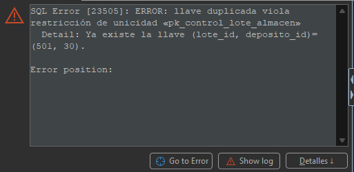
*Figura 1 – Prueba 5: insertar de nuevo `(501, 30)` viola `pk_control_lote_almacen` (error 23505); la PK `(lote_id, deposito_id)` del esquema original rechaza la clave repetida.*

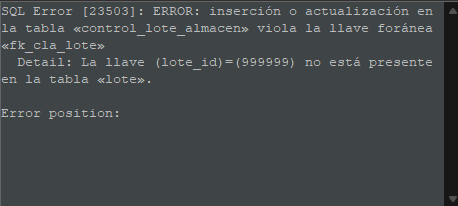
*Figura 2 – Prueba 5: insertar el lote 999999 viola `fk_cla_lote` (error 23503); la FK del esquema original rechaza un lote que no existe.*

## a) Dependencias funcionales

Regla de negocio: el control de un lote en un depósito lo realiza un responsable, y cada responsable pertenece a **un único depósito**. En notación formal:

- **DF1**: `{L, D} → R` (dado un lote y un depósito, el responsable queda determinado; es la PK).
- **DF2**: `R → D` (un responsable pertenece a un solo depósito).

Evidencia sobre la instancia (script, sección 1): la consulta `GROUP BY responsable_control_id HAVING count(DISTINCT deposito_id) > 1` devuelve **0 filas**, coherente con DF2 (801 → 30, 802 → 31). Una instancia no demuestra una DF; sólo es coherente con ella, la DF proviene de la regla de negocio.

## b) Clausuras y claves candidatas

Con `F = { {L,D} → R ; R → D }` y el esquema `{L, D, R}`:

| Conjunto X | Cálculo de X⁺ | X⁺ | ¿Superclave? |
|------------|---------------|----|--------------|
| `{L}` | ninguna DF aplicable | `{L}` | No |
| `{D}` | ninguna DF aplicable | `{D}` | No |
| `{R}` | `R → D` agrega D | `{R, D}` | No (falta L) |
| `{L, D}` | `{L,D} → R` agrega R | `{L, D, R}` | **Sí** |
| `{L, R}` | `R → D` agrega D | `{L, R, D}` | **Sí** |
| `{D, R}` | `R → D` no agrega nada nuevo | `{D, R}` | No (falta L) |

Claves candidatas (superclaves minimales): **`{L, D}`** y **`{L, R}`**. Ninguno de sus subconjuntos propios es superclave (ver filas de `{L}`, `{D}`, `{R}`).

**Atributos primos** (pertenecen a alguna clave candidata): L (en ambas), D (en `{L,D}`) y R (en `{L,R}`). Los **tres atributos son primos**; no hay atributos no primos.

## c) Forma normal

- **3FN: sí.** Para cada DF `X → A` no trivial, o X es superclave o A es primo. DF1: `{L,D}` es superclave. DF2: `R` no es superclave, pero `D` es primo. Cumple.
- **FNBC: no.** FNBC exige que el determinante de **toda** DF no trivial sea superclave. DF2 `R → D` es no trivial y `R⁺ = {R, D} ≠ {L, D, R}`: el determinante `R` no es superclave (no incluye a `L`). Por lo tanto **DF2 es la DF violatoria**.

Este es el caso clásico en que 3FN (que tolera determinantes no superclave si el dependiente es primo) es más débil que FNBC.

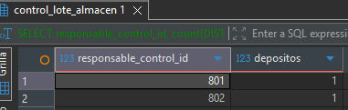
*Figura 3 – Prueba 6: cada responsable aparece con un solo depósito (801 y 802 con 1); sobre la instancia vale `R → D`.*

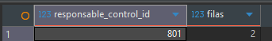
*Figura 4 – Prueba 6: el responsable 801 figura en 2 filas; el hecho «801 pertenece al depósito 30» está repetido, origen de las anomalías.*

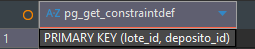
*Figura 5 – Prueba 6: la única clave declarada es `PRIMARY KEY (lote_id, deposito_id)`; `R`, determinante de `R → D`, no es superclave, por lo que se viola FNBC.*

## d) Anomalías

Todas surgen de que el hecho "el responsable 801 pertenece al depósito 30" está **repetido** en cada fila de control de ese responsable.

- **Anomalía de inserción.** No se puede registrar que un nuevo responsable (por ejemplo 900803) pertenece al depósito 30 mientras no controle algún lote, porque `L` es parte de la PK y no puede ser nulo. El hecho "900803 trabaja en el depósito 30" no tiene dónde almacenarse. Al revés, al asignarle un primer lote hay que repetir correctamente el depósito, y nada impide escribir `(504, 31, 801)`, contradiciendo DF2 (801 pertenece a 30) sin que la PK `(L, D)` lo detecte.
- **Anomalía de borrado.** Si se elimina la fila `(503, 31, 802)` (por ejemplo, el lote 503 deja de controlarse), se pierde el único registro de que el responsable 802 pertenece al depósito 31. Lo mismo ocurre con 801 y el depósito 30 si se borran las filas 501 y 502.
- **Anomalía de actualización.** Si el responsable 801 se traslada del depósito 30 al 31, hay que modificar **dos filas** (501 y 502). Si sólo se actualiza una, la instancia queda inconsistente: 801 aparecería en los depósitos 30 y 31 a la vez, violando DF2. Cuantos más lotes controle un responsable, más filas hay que mantener sincronizadas.

**Evidencia de las anomalías** (pruebas 7, 8 y 9; esquema original frente al descompuesto).

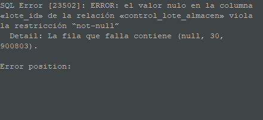
*Figura 6 – Prueba 7, inserción: registrar al responsable 900803 en el depósito 30 sin lote falla por `NOT NULL` en `lote_id` (error 23502); el hecho no tiene dónde guardarse en el esquema original.*

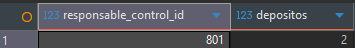
*Figura 7 – Prueba 7, inserción: el esquema original acepta una fila que pone a 801 en un segundo depósito; el responsable 801 queda en 2 depósitos y la PK `(L, D)` no lo detecta.*

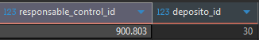
*Figura 8 – Prueba 7, solución: en `responsable_deposito` el responsable 900803 queda registrado en el depósito 30 sin necesidad de un lote.*

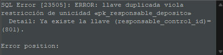
*Figura 9 – Prueba 7, solución: asignar 801 a un segundo depósito viola `pk_responsable_deposito` (error 23505); el esquema descompuesto impone `R → D`.*

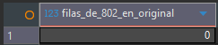
*Figura 10 – Prueba 8, borrado: tras eliminar el único control de 802, el esquema original tiene 0 filas de 802 y pierde que 802 pertenece al depósito 31.*

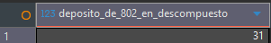
*Figura 11 – Prueba 8, borrado: en el esquema descompuesto el depósito de 802 se conserva (31) aunque se borre su control.*

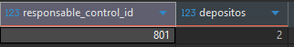
*Figura 12 – Prueba 9, actualización: en el esquema original, actualizar una sola fila deja a 801 en 2 depósitos (inconsistencia).*

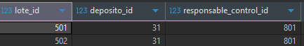
*Figura 13 – Prueba 9, actualización: en el descompuesto el traslado modifica una sola fila y la vista muestra 501 y 502 consistentes en el depósito 31.*

## e) Descomposición en FNBC

**Algoritmo aplicado** (descomposición por una DF violatoria): se toma `X → Y` con X no superclave; aquí `X = R`, `Y = D`, es decir **`R → D`**. Se reemplaza el esquema `S = {L, D, R}` por:

- **R1 = X ∪ Y = {R, D}** → tabla `responsable_deposito(responsable_control_id, deposito_id)`, clave `R`.
- **R2 = S − Y = {L, R}** → tabla `control_lote(lote_id, responsable_control_id)`, clave `{L, R}`.

**Por qué cada esquema está en FNBC** (el único determinante de toda DF no trivial es una superclave):

- `responsable_deposito(R, D)`: la única DF no trivial es `R → D` y `R` es su clave (`R⁺ = {R, D}`).
- `control_lote(L, R)`: se proyecta `F` sobre `{L, R}`, es decir, las DFs de `F⁺` cuyos atributos están contenidos en `{L, R}`. Se calculan las clausuras de los subconjuntos propios: `{L}⁺ = {L}` y `{R}⁺ ∩ {L, R} = {R, D} ∩ {L, R} = {R}`. Ninguna determina al otro atributo, por lo que la proyección **no tiene DFs no triviales**; el único determinante posible es la clave completa `{L, R}`, de modo que está en FNBC.

Dos consecuencias de diseño (las dos FKs `ON DELETE RESTRICT` preservan la trazabilidad del control de calidad): (1) `control_lote.responsable_control_id` referencia a `responsable_deposito` (no a `usuario`), de modo que todo responsable usado en un control tiene depósito asignado; (2) ambas tablas usan el **mismo nombre de columna** `responsable_control_id` para que la reunión natural opere exactamente por el atributo común.

Las anomalías del punto d) desaparecen: el hecho "el responsable pertenece a un depósito" se guarda **una sola vez** (se puede dar de alta un responsable sin lotes; borrar un control no borra la asignación; un traslado modifica una sola fila). Se verifica en `TP4/tests/test_fnbc_descomposicion.sql` (801 en el depósito 31 rechazado por PK, responsable sin depósito rechazado por FK, borrados `RESTRICT`).

Extracto del script (`TP4/tp_fnbc_control_lote.sql`, sección 2):

```sql
CREATE TABLE responsable_deposito (
    responsable_control_id BIGINT NOT NULL,
    deposito_id            BIGINT NOT NULL,
    CONSTRAINT pk_responsable_deposito PRIMARY KEY (responsable_control_id),
    CONSTRAINT fk_rd_responsable FOREIGN KEY (responsable_control_id) REFERENCES usuario (id)  ON DELETE RESTRICT,
    CONSTRAINT fk_rd_deposito    FOREIGN KEY (deposito_id)            REFERENCES deposito (id) ON DELETE RESTRICT
);

CREATE TABLE control_lote (
    lote_id                BIGINT NOT NULL,
    responsable_control_id BIGINT NOT NULL,
    CONSTRAINT pk_control_lote PRIMARY KEY (lote_id, responsable_control_id),
    CONSTRAINT fk_cl_lote        FOREIGN KEY (lote_id)                REFERENCES lote (id)                                    ON DELETE RESTRICT,
    CONSTRAINT fk_cl_responsable FOREIGN KEY (responsable_control_id) REFERENCES responsable_deposito (responsable_control_id) ON DELETE RESTRICT
);
```

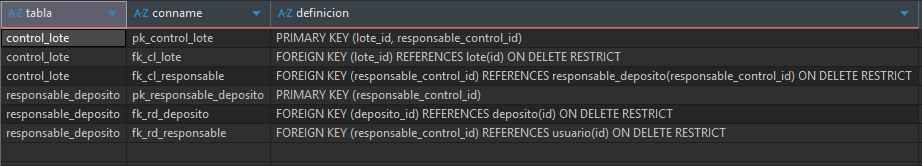
*Figura 14 – Prueba 10: claves primarias y claves foráneas `ON DELETE RESTRICT` de `control_lote` y `responsable_deposito`, tal como las crea el script.*

## f) Vista de compatibilidad, reunión sin pérdida y costo de la descomposición

**Migración y vista** (script, sección 3): se verifica antes la DF (`GROUP BY responsable_control_id HAVING count(DISTINCT deposito_id) > 1` → 0 filas), se migra con `INSERT ... SELECT DISTINCT` a `responsable_deposito` (2 filas: 801→30, 802→31) e `INSERT ... SELECT` a `control_lote` (3 filas) y se crea la vista:

```sql
CREATE VIEW v_control_lote_almacen AS
SELECT lote_id, deposito_id, responsable_control_id
FROM   control_lote NATURAL JOIN responsable_deposito;
```

**Unión sin pérdida.** Para una descomposición binaria `{R1, R2}` de `S` el criterio es que `R1 ∩ R2 → R1` o `R1 ∩ R2 → R2`. Aquí `R1 ∩ R2 = {R}` y `R → D` implica `R → {R, D} = R1`: el atributo común es **superclave (clave) de `responsable_deposito`**. Por eso cada fila de `control_lote` se une con exactamente una fila de `responsable_deposito` y la reunión no produce filas espurias ni pierde ninguna (la FK garantiza además que el responsable siempre existe en R1).

**Evidencia.** `control_lote_almacen EXCEPT v_control_lote_almacen` y `v_control_lote_almacen EXCEPT control_lote_almacen` devuelven **0 filas** y ambos conteos son 3. Verificado de forma automática en `TP4/tests/test_fnbc_vista_migracion.sql`. En la ejecución manual (prueba 11) los dos `EXCEPT` devolvieron 0 filas (resultado vacío, sin captura); sí se capturaron los conteos y el contenido de la vista.

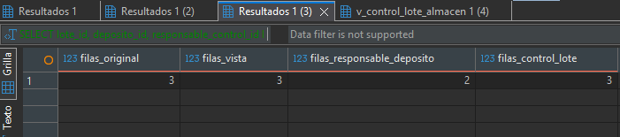
*Figura 15 – Prueba 11: 3 filas en el original, 3 en la vista, 2 en `responsable_deposito` y 3 en `control_lote`; la migración no pierde ni agrega filas.*

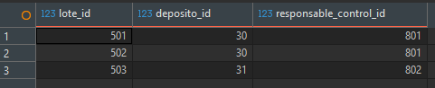
*Figura 16 – Prueba 11: `v_control_lote_almacen` reconstruye las filas originales (501, 30, 801), (502, 30, 801) y (503, 31, 802).*

**Costo: dependencia no preservada.** La DF `{L, D} → R` ya no es una restricción local: sus atributos quedaron en tablas distintas (`L` en `control_lote`, `D` en `responsable_deposito`), por lo que ninguna PK/UNIQUE puede imponerla. Demostración reproducible (script, final de la sección 3, dentro de una transacción revertida): se agrega el responsable 900803 al depósito 30 y se inserta el control `(501, 900803)`; el esquema lo **acepta** y la vista muestra dos responsables para `(501, 30)`, algo que la PK `(L, D)` del esquema original impedía. Mitigaciones posibles: (i) un disparador de verificación en `control_lote`/`responsable_deposito` que rechace un segundo responsable para el mismo `(L, D)`; (ii) conservar `deposito_id` en `control_lote` con una FK compuesta hacia `responsable_deposito(responsable_control_id, deposito_id)` más `UNIQUE (lote_id, deposito_id)`. Esa FK compuesta exige que en `responsable_deposito` exista una restricción `UNIQUE (responsable_control_id, deposito_id)` (el destino de una FK debe ser PK o UNIQUE), y el resultado es en la práctica **el esquema original no-FNBC con una guarda**: `control_lote(L, D, R)` vuelve a repetir `D` para cada control y reintroduce la redundancia y las anomalías, aunque la FK compuesta impide que queden inconsistentes. **Decisión del equipo: no se implementa ninguna de las dos; la pérdida se documenta y demuestra** (es el trade-off clásico de FNBC frente a 3FN, que siempre preserva dependencias).

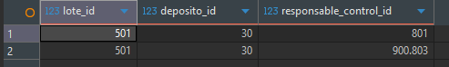
*Figura 17 – Prueba 12: la vista muestra dos responsables (801 y 900803) para el mismo `(501, 30)`; el esquema descompuesto no impone `{L, D} → R`, que la PK original sí impedía.*


# Parte 2 – Desnormalización controlada: top 5 de categorías del día

> Artefactos de la Parte 2: `TP4/tp_desnormalizacion_top_categorias.sql`, `TP4/tests/test_*.sql` (excepto `test_fnbc_*`) y `TP4/evidencias/`.

## Adaptaciones al schema real y datos de prueba

La consigna asume un schema que la base `tp4_foodstore` (clon de `food_store_copia`) no tiene exactamente; se adaptó así:

| Consigna | Schema real / decisión | Dónde |
|----------|------------------------|-------|
| `detalle_pedido` | La tabla se llama `pedido_detalle` (PK `(pedido_id, producto_id)`). | todo el script |
| Columna `eliminado` | No existía. Se agregó `eliminado BOOLEAN NOT NULL DEFAULT FALSE` a `pedido` y `pedido_detalle` (cambio de catálogo en PG ≥ 11, sin reescritura; el histórico queda en `FALSE`). | sección 1, `test_baja_logica.sql` |
| `ped.fecha = CURRENT_DATE` | `pedido.fecha` es `TIMESTAMPTZ`: comparar con una fecha equivale a la medianoche exacta y casi nunca coincide. Se filtra por **rango del día de negocio** (`fecha >= inicio AND fecha < inicio + 1 día`), sargable sobre `idx_pedido_fecha`. | sección 3 |
| "El día" | Función `fn_dia_negocio(timestamptz)` `IMMUTABLE` con zona fija `America/Argentina/Buenos_Aires`, para no depender de la zona de la sesión. | sección 1, `test_dia_negocio.sql` |
| Tablas casi vacías hoy | La base tenía 0 pedidos del día. Se generan con `generate_series` ≈ 50 000 pedidos y 150 000 detalles del día (1 de cada 20 pedidos y 1 de cada 25 detalles con `eliminado = TRUE`), 7 categorías nuevas (total 10) y se redistribuyen los productos por `id % 10`. La sección es **solo para la copia**, tiene guarda anti-duplicado y corre antes de crear disparadores. | sección 2, `test_datos_prueba.sql` |
| Desempate del top 5 | `ORDER BY total_vendido DESC` no es determinista ante empates; se agrega `nombre` como segundo criterio en la consulta normalizada y en la desnormalizada. | secciones 3 y 5 |

Fecha de las mediciones: **2026-10-18** (los datos del día se generan en función de la fecha de ejecución).

**Advertencia sobre la re-ejecución.** La guarda anti-duplicado de la sección 2 cuenta los detalles vigentes del día de negocio *actual*: re-ejecutarla el mismo día no agrega nada, pero re-ejecutarla **otro día** agrega otros ≈ 50 000 pedidos y 150 000 detalles (el volumen acumulado crece una vez por día de ejecución).

## a) Medición baseline de la consulta normalizada

Consulta (sección 3 del script; devuelve 5 filas: Lácteos 190 001 983,35; Congelados 188 996 044,10; Golosinas 151 840 063,72; Panadería 150 872 583,56; Carnes 122 887 183,95):

```sql
SELECT c.nombre AS categoria, SUM(dp.subtotal) AS total_vendido
FROM   pedido_detalle dp
JOIN   pedido ped ON ped.id = dp.pedido_id
JOIN   producto pr ON pr.id = dp.producto_id
JOIN   categoria c ON c.id = pr.categoria_id
WHERE  ped.fecha >= <inicio del día de negocio> AND ped.fecha < <inicio> + INTERVAL '1 day'
  AND  ped.eliminado = FALSE AND dp.eliminado = FALSE
GROUP  BY c.nombre ORDER BY total_vendido DESC, c.nombre LIMIT 5;
```

`EXPLAIN (ANALYZE, BUFFERS)` ejecutado tres veces consecutivas (caché de PostgreSQL caliente pero no exacta: cada ejecución todavía leyó ≈ 1 500–2 100 buffers de disco, lo que no altera la conclusión; salidas completas en `TP4/evidencias/explain_antes.txt`): **141,857 ms / 138,899 ms / 142,337 ms → mediana 141,857 ms** (≈ 9 000–9 500 buffers en caché y ≈ 1 500–2 100 leídos por ejecución).

**Nodo dominante.** El costo lo concentra la cadena de `Hash Join` que arranca en un `Parallel Seq Scan on pedido_detalle` (≈ 33 ms por proceso, 255 067 filas por proceso, el 100 % de las ~771 000 filas de la tabla): `pedido_detalle` no tiene fecha, por lo que el filtro del día sólo puede aplicarse *después* de unir con `pedido` (el `Bitmap Index Scan` sobre `idx_pedido_fecha` resuelve bien las 50 000 filas del día en ≈ 2 ms, pero no evita recorrer todos los detalles). A eso se suma un `Seq Scan` completo de `producto` (50 005 filas, hash) en cada uno de los 3 procesos. Entre los Hash Join y el agregado parcial se procesan ≈ 137 000 filas (3 × 45 667) para producir sólo 10 grupos: el trabajo es proporcional al volumen de ventas del día, no al número de categorías, y se repite íntegro cada vez que se abre el panel.

**Medición del autor.** En la corrida manual del autor (prueba 18, DBeaver, una ejecución) el mismo `EXPLAIN (ANALYZE, BUFFERS)` dio **Execution Time 139,769 ms** y 11 077 buffers (`shared hit`), con el mismo plan que midió el agente (2 workers, es decir 3 procesos).

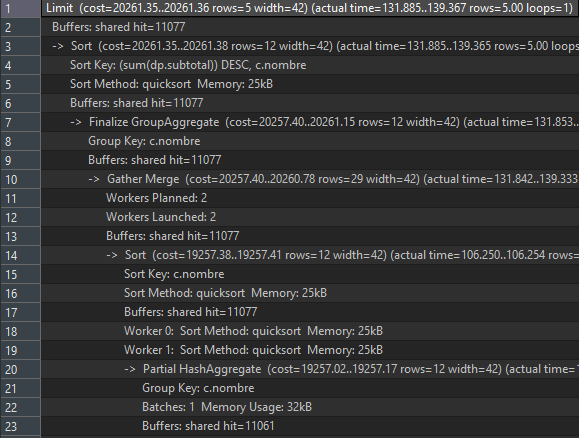
*Figura 18 – Prueba 18, consulta normalizada (parte 1 del plan): `Limit`, `Sort`, `Finalize GroupAggregate` y `Gather Merge` con 2 workers; 11 077 buffers.*

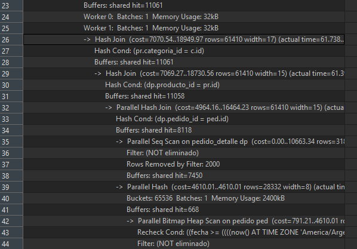
*Figura 19 – Prueba 18 (parte 2): la cadena de `Hash Join` arranca en un `Parallel Seq Scan on pedido_detalle` (7 450 buffers) que descarta las filas eliminadas.*

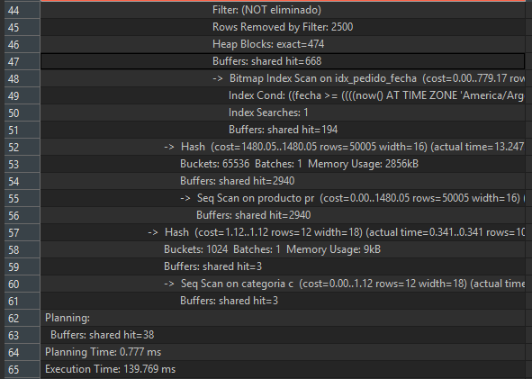
*Figura 20 – Prueba 18 (parte 3): `Bitmap Index Scan` sobre `idx_pedido_fecha` para el filtro del día y `Seq Scan` completo de `producto` (50 005 filas).*

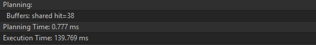
*Figura 21 – Prueba 18: Planning Time 0,777 ms y Execution Time 139,769 ms de la consulta normalizada.*

## b) Justificación de la desnormalización

El patrón aplicado es el que propone la consigna, **columna precalculada mantenida con disparador**, en su variante de **tabla de totales** (`ventas_diarias_categoria`, un agregado por día y categoría en lugar de una columna en cada fila). La consulta normalizada tarda **141,857 ms** (mediana de 3 ejecuciones, `TP4/evidencias/explain_antes.txt`) porque cada vez que se abre el panel recorre completo `pedido_detalle` (≈ 771 000 filas) y lo une con `pedido` y `producto` para producir sólo 10 totales, y como el reporte es "en tiempo real" y se consulta muchas veces por minuto ese costo, proporcional al volumen de ventas del día y no al número de categorías, se repite íntegro en cada lectura, mientras que guardar el total por `(día, categoría)` en `ventas_diarias_categoria` (a lo sumo 10 filas por día) lo convierte en una lectura por clave primaria; el costo de la redundancia es que el dato derivado puede desincronizarse de la fuente, y se controla con tres mecanismos: disparadores `AFTER ... FOR EACH ROW` sobre `pedido_detalle`, `pedido` y `producto` que aplican el delta en la **misma transacción** que modifica la fuente (un `ROLLBACK` deshace ambos, no hay ventana de datos viejos y la actualización es atómica gracias al `INSERT ... ON CONFLICT DO UPDATE`), una carga inicial bajo `LOCK TABLE ... SHARE ROW EXCLUSIVE` que evita que una escritura concurrente quede fuera, y un script de auditoría (punto e) que recalcula desde la fuente y debe devolver 0 filas; además la estructura es **reversible sin pérdida** (basta `DROP TRIGGER`/`DROP FUNCTION`/`DROP TABLE`, verificado en `test_reversibilidad.sql`, porque la fuente nunca se modifica), y se eligió esta alternativa en lugar de una **vista materializada** porque ésta sólo es exacta inmediatamente después de un `REFRESH` y refrescarla recalcula todo el histórico (el mismo costo que se pretende evitar, y `REFRESH ... CONCURRENTLY` exige un índice único y sigue siendo un recálculo completo), de modo que un panel en tiempo real vería datos viejos o pagaría el costo completo en cada ciclo.

## c) Estructura, disparadores y casos borde

**Estructura** (sección 4 del script):

```sql
ventas_diarias_categoria(
  fecha DATE NOT NULL, categoria_id BIGINT NOT NULL REFERENCES categoria(id) ON DELETE RESTRICT,
  total_vendido NUMERIC(14,2) NOT NULL CHECK (total_vendido >= 0),
  cantidad_lineas INTEGER NOT NULL CHECK (cantidad_lineas >= 0),
  actualizado_en TIMESTAMPTZ NOT NULL DEFAULT now(),
  PRIMARY KEY (fecha, categoria_id))
```

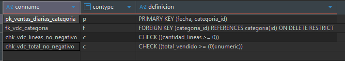
*Figura 22 – Prueba 16: restricciones de `ventas_diarias_categoria`: PK `(fecha, categoria_id)`, FK a `categoria` `ON DELETE RESTRICT` y dos `CHECK` de no negatividad.*

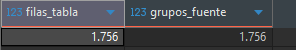
*Figura 23 – Prueba 16: la tabla tiene 1 756 filas y la fuente agrupada 1 756 grupos; la carga inicial coincide con la fuente.*

- **`NUMERIC(14,2)`** en lugar de `NUMERIC(10,2)`: es un agregado (en los datos de prueba hay ≈ 15 000 líneas por categoría y día y cada total ronda 1,2 × 10⁸–1,9 × 10⁸; con `NUMERIC(10,2)` el máximo es 99 999 999,99), excepción justificada a la regla de montos del proyecto.
- **Desviaciones de las directivas de DDL de AGENTS.md (justificadas).** (i) PK **compuesta natural** `(fecha, categoria_id)` en lugar de `BIGINT GENERATED ALWAYS AS IDENTITY`: la identidad de un agregado es el par (día, categoría), esa clave es la que habilita el upsert `ON CONFLICT (fecha, categoria_id)` y el filtro por prefijo `fecha = hoy`; una clave subrogada exigiría además un `UNIQUE (fecha, categoria_id)`. (ii) `fecha` es `DATE` (día de negocio) y no `TIMESTAMPTZ NOT NULL DEFAULT now()`: es la clave de agregación, no el instante de alta; el instante de la última actualización está en `actualizado_en`, que sí es `TIMESTAMPTZ NOT NULL DEFAULT now()`. (iii) `NUMERIC(14,2)` en vez de `NUMERIC(10,2)` (arriba).
- Se guarda **`categoria_id`** y no el nombre; el reporte une con `categoria` (≤ 10 filas) sólo para mostrarlo. La PK `(fecha, categoria_id)` sirve al filtro `fecha = hoy`, por eso no hay índice adicional.
- **`cantidad_lineas`** permite borrar la fila cuando llega a 0: la tabla coincide con la consulta normalizada también para categorías sin ventas.

**Regla de contribución.** Una línea cuenta sii `pedido_detalle.eliminado = FALSE AND pedido.eliminado = FALSE`; su clave es `(fn_dia_negocio(pedido.fecha), producto.categoria_id)` con la **categoría actual** (no se congela a la fecha de venta: la fuente de verdad, la consulta de la consigna, usa la categoría actual; congelarla haría divergir reporte y auditoría).

| Disparador | Evento | Efecto |
|------------|--------|--------|
| `trg_vdc_pedido_detalle` | `INSERT` / `UPDATE OF subtotal, producto_id, pedido_id, eliminado` / `DELETE` | quita la línea vieja (si contribuía) y agrega la nueva (si contribuye); un solo camino cubre alta, cambio de subtotal, de producto, de pedido, baja lógica, reactivación y borrado físico |
| `trg_vdc_pedido` | `UPDATE OF eliminado, fecha` (`WHEN` valor distinto) | resta los detalles vigentes del pedido con el estado/fecha viejos y los suma con los nuevos |
| `trg_vdc_producto` | `UPDATE OF categoria_id` (`WHEN` valor distinto) | para cada día con ventas del producto, mueve el monto de la categoría vieja a la nueva |

Todo pasa por `fn_vdc_aplicar`: con delta positivo hace `INSERT ... ON CONFLICT DO UPDATE` (atómico ante concurrencia, la fila queda bloqueada hasta el commit); con delta negativo hace `UPDATE` y luego `DELETE` si la fila quedó en 0 líneas (un `INSERT` con delta negativo violaría el `CHECK` antes de resolver el conflicto). Si falta la fila a decrementar, la función aborta con un error explícito en lugar de ocultar la desincronización.

**Casos borde verificados** (`test_trigger_detalle.sql`, `test_trigger_pedido_producto.sql`, con deltas exactos): alta +100,00; subtotal 100→250 = +150,00; cambio de producto entre categorías y dentro de la misma; baja lógica/reactivación (dos ciclos); borrado físico (también de un detalle ya eliminado: no resta); la fila desaparece al quitar la última línea; cambio de `pedido_id` del detalle; detalle de un pedido eliminado no suma; baja lógica de pedido con dos categorías y reactivación (el detalle ya eliminado no reaparece); `TRUE → TRUE` no resta dos veces; cambio de fecha hoy→ayer→día lejano y dentro del mismo día; pedido de las 23:30 con sesión en UTC; recategorización con ventas en varios días, con productos sin ventas y con detalle/pedido eliminados; `ROLLBACK` sin residuos.

**Concurrencia.** El análisis completo está también en el script (sección 4) y en `design.md` (decisión 14); aquí el resumen. Se trabaja en `READ COMMITTED`.

*Escenario sin protección (T1/T2), paso a paso.* (1) T1 ejecuta `UPDATE pedido SET eliminado = TRUE WHERE id = 7`; su disparador lee los detalles del pedido 7 y **resta** su aporte. (2) T2, antes de que T1 confirme, ejecuta `INSERT INTO pedido_detalle (pedido_id = 7, ...)`; su disparador lee el pedido 7, lo ve todavía con `eliminado = FALSE` y **suma** la línea. (3) Ambas confirman. T1 no vio el detalle de T2 y T2 no vio la baja de T1: queda una línea sumada que nadie restó (total de más; la auditoría lo detecta). Con `producto.categoria_id` ocurre lo análogo.

*Por qué los bloqueos existentes no lo evitan.* El `INSERT` en `pedido_detalle` toma, por las claves foráneas, `FOR KEY SHARE` sobre las filas de `pedido` y `producto`; el `UPDATE` de `eliminado`, `fecha` o `categoria_id` no toca columnas de clave y toma `FOR NO KEY UPDATE`. Esos dos modos son **compatibles**, así que ninguna transacción espera a la otra.

*Qué cierra `FOR SHARE OF p, pr`.* `fn_vdc_linea` lee `pedido` y `producto` con `FOR SHARE`, que **sí** conflictúa con `FOR NO KEY UPDATE` y retiene el bloqueo hasta el commit del detalle. Si T1 llega después, su `UPDATE` espera a T2 y al despertar su disparador (snapshot nuevo) ya ve el detalle de T2 y lo resta; si T1 llegó primero, T2 espera, relee la fila actualizada (`eliminado = TRUE`) y no suma. **El bloqueo se toma también cuando el pedido ya está eliminado**: `fn_vdc_linea` lee `p.eliminado` junto con `FOR SHARE` sin filtrarlo en el `WHERE` y decide *después* (una versión anterior filtraba `NOT p.eliminado` en el `WHERE`, de modo que un pedido eliminado no tomaba ningún bloqueo; fue corregido tras la segunda revisión). Caso espejo, **reactivación**: T1 ejecuta `UPDATE pedido SET eliminado = FALSE` sobre un pedido eliminado y su disparador **suma** los detalles vigentes que ve; si T2 inserta mientras tanto un detalle del mismo pedido sin tomar bloqueo, lee `eliminado = TRUE`, no suma y la línea se pierde al confirmar T1. Con el bloqueo, T2 espera a T1, relee `eliminado = FALSE` y suma; si T2 llegó primero, T1 espera y su disparador ya ve el detalle de T2 y lo suma. En los escenarios analizados (baja y reactivación, en ambos órdenes de llegada) el resultado es correcto. Esto está verificado **estructuralmente** en `test_concurrencia.sql` (el bloqueo está declarado); una prueba de espera real exige dos sesiones simultáneas, que el MCP (una sentencia por llamada) no permite, y queda como prueba manual con dos sesiones `psql`.

*Costo.* (a) Contención: las filas de `pedido` y `producto` leídas quedan protegidas contra `UPDATE` hasta el commit; en particular un `UPDATE producto SET stock = ...` concurrente espera a que terminen las ventas en curso de ese producto. (b) Deadlocks posibles: dos ventas del mismo producto que hacen primero el `INSERT` (cada una con `FOR SHARE`) y luego `UPDATE producto SET stock` (que necesita `FOR NO KEY UPDATE`) se esperan mutuamente; mitigación: actualizar el stock *antes* de insertar los detalles, u ordenar siempre igual los productos; PostgreSQL detecta el deadlock, aborta una transacción y la aplicación reintenta. (c) Fila caliente: las ventas simultáneas de la misma categoría y día se serializan en la fila `(fecha, categoría)` hasta el commit (aceptado al volumen del TP; mitigación futura: contadores fragmentados), y tocar categorías A y B en orden inverso también puede producir deadlock. (d) Ciclos nuevos que introduce `FOR SHARE`: *pedido ↔ fila de totales* y *producto ↔ fila de totales*. Ejemplo: T2 ya vendió una línea de la categoría C ese día (tiene bloqueada la fila `(hoy, C)`) y ahora inserta otro detalle del pedido 7 (necesita `FOR SHARE` sobre ese pedido), mientras T1 hizo `UPDATE pedido SET eliminado` sobre el pedido 7 (tiene la fila del pedido y quiere actualizar `(hoy, C)`): se esperan mutuamente; análogo con `UPDATE producto SET categoria_id` (tiene la fila del producto y quiere las filas de totales) contra una venta de ese producto. PostgreSQL detecta el ciclo y **aborta una de las transacciones** con el error de deadlock (se revierte entera, sin corrupción) y la aplicación reintenta. La mitigación ya está en uso en el proyecto: el procedimiento real `Proyecto_Integrador/database/procedures.sql` (líneas 110-114) toma `SELECT ... FOR UPDATE` sobre `producto` *antes* de insertar el detalle, es decir, toma primero el bloqueo fuerte.

*Carrera residual (no cerrada).* La baja lógica o el cambio de fecha de un **pedido** frente a la recategorización simultánea de un **producto** que ese pedido contiene: ambos disparadores leen sin bloquearse mutuamente, y el segundo, que no ve la baja sin confirmar, mueve de categoría una línea que el primero ya restó de la categoría vieja. Es una operación administrativa muy infrecuente; mitigaciones: ejecutar ambas operaciones en transacciones `SERIALIZABLE` (una aborta por error de serialización y se reintenta), o aceptar la ventana, detectarla con la auditoría y reconstruir.

*Caso exótico no soportado.* Una única sentencia con CTE modificante que cambia `pedido.eliminado` e inserta detalles del mismo pedido: los disparadores `AFTER` corren al final, con la baja ya visible, de modo que el del detalle no suma las líneas nuevas pero el del pedido las resta; la sentencia aborta con el error "desincronizada" si falta la fila (o la auditoría lo detecta). Se evita separando baja y alta en sentencias distintas.

*Reconstrucción.* Si la auditoría devuelve filas, se vuelve a ejecutar el bloque de instalación (`LOCK TABLE ... SHARE ROW EXCLUSIVE` + `TRUNCATE ventas_diarias_categoria` + carga inicial), que es idempotente y deja la tabla igual a la fuente; mientras corre, las escrituras en las fuentes esperan.

*`TRUNCATE`.* `TRUNCATE` de `pedido` o `pedido_detalle` no dispara disparadores de fila y desincronizaría la tabla sin aviso, por eso un disparador `BEFORE TRUNCATE` (`trg_vdc_truncate_pedido`, `trg_vdc_truncate_detalle`) lo rechaza con un error explícito (verificado en `test_concurrencia.sql`); `TRUNCATE producto` ya lo impiden las FK y con `CASCADE` (también `TRUNCATE categoria CASCADE`) la cascada alcanza a `pedido_detalle` y dispara el mismo bloqueo, por lo que la sentencia aborta (verificado en `test_concurrencia.sql`). Para vaciar las fuentes se usa `DELETE` (que sí sincroniza) o se retira antes la desnormalización.

*Alcance de la garantía.* Con `FOR SHARE` (también sobre pedidos eliminados) y los disparadores la tabla queda consistente en los **escenarios de concurrencia analizados** (baja y reactivación de pedido, alta de detalle, en ambos órdenes, en `READ COMMITTED`); **no es una garantía absoluta**: quedan la carrera residual, el caso exótico y cualquier interleaving no contemplado en este análisis, y por eso existe la auditoría. Recategorizar un producto con mucho historial es costoso (usa `idx_detalle_producto_id`, que viene del TP3 y no está en `schema.sql` del integrador).

**Carga inicial con bloqueo.** El bloque de instalación es una única sentencia/transacción: `LOCK TABLE pedido, pedido_detalle, producto IN SHARE ROW EXCLUSIVE MODE` → crear disparadores → `TRUNCATE` + `INSERT ... SELECT ... GROUP BY` de todo el histórico. Mientras corre la instalación, las escrituras concurrentes en las tres tablas fuente esperan, por lo que ninguna escritura queda fuera de la carga inicial ni de los disparadores recién creados (la consistencia posterior en operación normal depende de lo descripto en *Concurrencia*).

## d) Consulta desnormalizada y medición final

```sql
SELECT c.nombre AS categoria, v.total_vendido
FROM   ventas_diarias_categoria v
JOIN   categoria c ON c.id = v.categoria_id      -- sólo para mostrar el nombre (≤ 10 filas)
WHERE  v.fecha = fn_dia_negocio(now())
ORDER  BY v.total_vendido DESC, c.nombre
LIMIT  5;
```

Se publica también como vista `v_top5_categorias_dia` (un `SELECT` simple: el planificador la expande y el plan es el mismo). `test_reporte_top5.sql` verifica que devuelve las mismas 5 filas, en el mismo orden y con los mismos montos que la consulta normalizada (`EXCEPT` en ambos sentidos = 0, comparando además la posición con `row_number()`), y repite la comparación después de hacer entrar a la categoría del 6.º puesto al top 5 con una venta adicional (revertida).

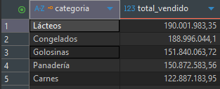
*Figura 24 – Prueba 17: top 5 de la consulta normalizada (Lácteos, Congelados, Golosinas, Panadería, Carnes).*

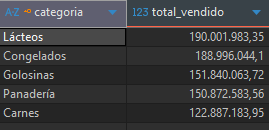
*Figura 25 – Prueba 17: la consulta sobre `ventas_diarias_categoria` devuelve las mismas 5 categorías, con los mismos montos y el mismo orden que la Figura 24.*

| | Antes (normalizada) – agente (MCP) | Antes – autor (DBeaver) | Después (desnormalizada) – agente (MCP) | Después – autor (DBeaver) |
|---|---|---|---|---|
| Execution Time | 141,857 / 138,899 / 142,337 ms (3 ejecuciones) | 139,769 ms (1 ejecución) | 0,104 / 0,100 / 0,101 ms (3 ejecuciones) | 0,112 ms (1 ejecución) |
| **Valor de referencia** | **141,857 ms** (mediana) | **139,769 ms** | **0,101 ms** (mediana; ≈ 1 400 veces menos) | **0,112 ms** (≈ 1 250 veces menos) |
| Buffers por ejecución | 11 072 (hit + read, igual en las 3) | 11 077 (hit) | 13 (hit) | 12 (hit) |
| Nodo dominante | `Parallel Seq Scan` de `pedido_detalle` (771 201 filas, 3 procesos) + `Hash Join` con `Seq Scan` de `producto` | el mismo (Figuras 18 a 21) | `Bitmap Index Scan` por `pk_ventas_diarias_categoria` (10 filas) | el mismo (Figuras 26 y 27) |
| Filas procesadas hasta el agregado | ≈ 137 000 (3 × 45 667) → 10 grupos | – | 10 | 10 |

*Fuente de cada columna: «agente» = mediciones automatizadas a través del MCP `postgres` (`TP4/evidencias/explain_*.txt`); «autor» = corrida manual del propio autor en DBeaver sobre la misma base, el mismo día, una sola ejecución por consulta (Figuras 18 a 21 y 26 y 27). Las diferencias entre columnas (≈ 1,5 % antes; 0,10 frente a 0,11 ms después) son variación normal entre equipos y ejecuciones; la conclusión (orden de magnitud y cambio de plan) es la misma en ambas fuentes.*

**Lectura de los planes.** Antes, el trabajo crece con el número de líneas vendidas en el día: se lee entera `pedido_detalle`, se une con 50 000 pedidos del día y 50 005 productos y recién entonces se agrupa en 10 categorías (sólo para quedarse con 5). Después, el filtro `fecha = hoy` usa el prefijo de la PK `(fecha, categoria_id)` y devuelve directamente las 10 filas ya agregadas; el `Hash Join` con `categoria` y el `Sort` operan sobre 10 filas, de modo que el costo ya no depende del volumen de ventas. Los planes completos están en `TP4/evidencias/explain_antes.txt` y `explain_despues.txt`. El precio de esta mejora se paga en escritura: cada alta, cambio o baja de un detalle ejecuta además un upsert sobre la fila `(día, categoría)`.

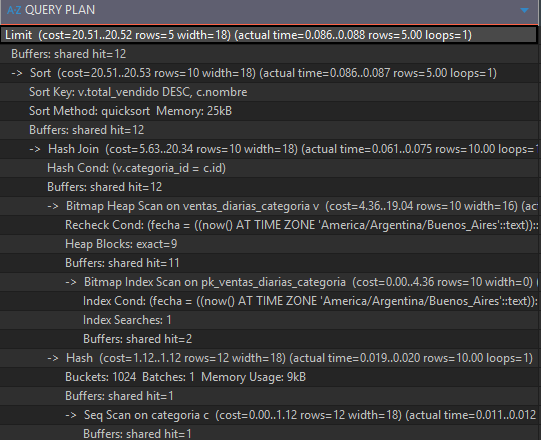
*Figura 26 – Prueba 19, consulta desnormalizada: `Bitmap Index Scan` sobre `pk_ventas_diarias_categoria` (10 filas), `Hash Join` con `categoria` y `Sort`; 12 buffers.*

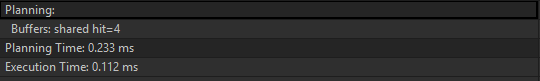
*Figura 27 – Prueba 19: Planning Time 0,233 ms y Execution Time 0,112 ms de la consulta desnormalizada.*

## e) Auditoría de desincronización

Sección 6 del script, publicada como vista `v_auditoria_ventas_diarias`:

```sql
WITH fuente AS (
  SELECT fn_dia_negocio(ped.fecha) AS fecha, pr.categoria_id, SUM(dp.subtotal) AS total, COUNT(*)::int AS lineas
  FROM pedido_detalle dp JOIN pedido ped ON ped.id = dp.pedido_id JOIN producto pr ON pr.id = dp.producto_id
  WHERE NOT ped.eliminado AND NOT dp.eliminado GROUP BY 1, 2)
SELECT COALESCE(f.fecha, v.fecha) AS fecha, COALESCE(f.categoria_id, v.categoria_id) AS categoria_id,
       f.total AS total_fuente, v.total_vendido AS total_tabla, f.lineas AS lineas_fuente, v.cantidad_lineas AS lineas_tabla
FROM fuente f FULL OUTER JOIN ventas_diarias_categoria v ON v.fecha = f.fecha AND v.categoria_id = f.categoria_id
WHERE f.total IS DISTINCT FROM v.total_vendido OR f.lineas IS DISTINCT FROM v.cantidad_lineas;
```

**Criterio de comparación.** Se recalcula desde la fuente de verdad todo el histórico con el mismo criterio de contribución que los disparadores (`eliminado = FALSE` en pedido y detalle, `fn_dia_negocio`, categoría actual) y se compara con `FULL OUTER JOIN` y `IS DISTINCT FROM` sobre **total y cantidad de líneas**. Una fila de salida significa que la clave `(fecha, categoria_id)` tiene un total distinto, **falta** en la tabla redundante (`total_tabla IS NULL`) o **sobra** en ella (`total_fuente IS NULL`). Recorre todo el historico: es una tarea de auditoría programada, no del panel.

**Evidencia.** Tras la carga inicial y después de ejecutar todos los tests de disparadores la auditoría devuelve **0 filas** (`TP4/evidencias/auditoria.txt`, obtenida mediante el MCP `postgres`, no desde una sesión `psql`). `test_auditoria.sql` verifica además que detecta, dentro de transacciones revertidas: un total alterado a mano (devuelve exactamente esa fila, con diferencia 1,00), una cantidad de líneas alterada, una fila borrada, una fila de más y una desincronización real de la fuente con el disparador deshabilitado; `test_trigger_detalle.sql` y `test_trigger_pedido_producto.sql` terminan cada escenario con la aserción "auditoría = 0 filas".


# Verificación integral

Resultado de la verificación final sobre `tp4_foodstore` (2026-10-18), con el estado de la base: 250 002 pedidos, 771 201 detalles, 10 categorías, 1 756 filas en `ventas_diarias_categoria`, 5 disparadores `trg_vdc_*`, auditoría con 0 filas.

| # | Test (`TP4/tests/`) | Qué verifica | Resultado |
|---|---------------------|--------------|-----------|
| 1 | `test_fnbc_esquema_original.sql` | Instancia 501/502/503, PK y FK del esquema original | pasa |
| 2 | `test_fnbc_descomposicion.sql` | PK y FK `RESTRICT` de la descomposición, rechazos | pasa |
| 3 | `test_fnbc_restricciones_indices.sql` | CHECK, `NOT NULL` por defecto e índices | pasa |
| 4 | `test_fnbc_vista_migracion.sql` | `EXCEPT` en ambos sentidos, conteos, DF `{L,D} → R` no preservada | pasa |
| 5 | `test_baja_logica.sql` | `eliminado BOOLEAN NOT NULL DEFAULT false` | pasa |
| 6 | `test_dia_negocio.sql` | `fn_dia_negocio` con sesión en UTC y en Buenos Aires, `IMMUTABLE` | pasa |
| 7 | `test_datos_prueba.sql` | ≥ 8 categorías con ventas hoy, ≥ 100 000 detalles vigentes, eliminados | pasa |
| 8 | `test_ventas_diarias_estructura.sql` | PK, FK, CHECK; tabla = fuente tras la carga inicial | pasa |
| 9 | `test_trigger_detalle.sql` | Alta, subtotal, producto, baja/reactivación, borrado, última línea, `ROLLBACK` | pasa |
| 10 | `test_trigger_pedido_producto.sql` | Baja lógica y fecha de pedido, recategorización de producto | pasa |
| 11 | `test_reporte_top5.sql` | Top 5 desnormalizado = normalizado (también con una venta que cambia el top) | pasa |
| 12 | `test_auditoria.sql` | Auditoría vacía y detección de alteraciones | pasa |
| 13 | `test_reversibilidad.sql` | Reversión sin tocar la fuente | pasa |
| 14 | `test_concurrencia.sql` | `FOR SHARE` declarado y `TRUNCATE` bloqueado (estructural) | pasa |

**Cómo se ejecutó.** Los 14 tests se ejecutaron contra `tp4_foodstore` a través del MCP `postgres`, que acepta **una sentencia por llamada**: cada bloque `DO` se envió completo y los `CREATE`/`DROP FUNCTION` de ayuda se enviaron por separado. Los dos scripts de entrega se verificaron en esa modalidad sentencia a sentencia y, además, el autor los ejecutó completos con `psql -f` (ver *Evidencia de ejecución manual*). Después de los tests, la base quedó como antes de empezar (mismos conteos, auditoría con 0 filas, sin funciones de ayuda `t4_*`).

**Cobertura de la consigna.**

| Punto | Dónde se resuelve |
|-------|-------------------|
| Parte 1 a)–f) | secciones a) a f) de la Parte 1; `tp_fnbc_control_lote.sql`; tests 1–4 |
| Parte 2 a) medición baseline | sección a); `evidencias/explain_antes.txt` |
| Parte 2 b) justificación | sección b) (un solo párrafo) |
| Parte 2 c) estructura y disparadores | sección c); sección 4 del script; tests 8–10, 13, 14 |
| Parte 2 d) consulta y medición final | sección d); `evidencias/explain_despues.txt`; test 11 |
| Parte 2 e) auditoría | sección e); `evidencias/auditoria.txt`; test 12 |

Las 28 pruebas manuales de `TP4/pruebas_manuales.md` repiten estas comprobaciones con SQL listo para pegar y cubren además la ejecución de los scripts con `psql -f` y la prueba de concurrencia con dos sesiones. El autor ejecutó y aprobó las pruebas 1 a 19; las pruebas 20 a 28 siguen pendientes (ver la sección siguiente).


# Evidencia de ejecución manual

El autor ejecutó a mano, sobre `tp4_foodstore` y el 2026-10-18, las **pruebas 1 a 19** de `TP4/pruebas_manuales.md`, y **todas dieron el resultado esperado**:

| Pruebas | Qué cubren | Evidencia en este informe |
|---------|------------|---------------------------|
| 1 a 3 | `psql -v ON_ERROR_STOP=1 -f` de los dos scripts (carga limpia y re-ejecución) y la suite de tests automáticos: **14/14** | sin captura (salida de `psql`) |
| 4 a 12 | Parte 1: instancia original, PK/FK, violación de FNBC, tres anomalías, descomposición, migración, vista y dependencia no preservada | Figuras 1 a 17 |
| 13 a 17 | Parte 2 base: `eliminado`, día de negocio, datos del día, estructura y carga inicial de `ventas_diarias_categoria`, top 5 desnormalizado = normalizado | Figuras 22 a 25 |
| 18 y 19 | `EXPLAIN (ANALYZE, BUFFERS)` antes y después | Figuras 18 a 21 y 26 y 27 |

Pendientes de ejecución manual: las pruebas 20 a 28 (disparadores, auditoría, `TRUNCATE`, concurrencia con dos sesiones y reversión), que sólo se verificaron con los tests automáticos y a través del MCP.

**Defectos reales detectados y corregidos durante esas corridas.** Dos problemas que la verificación automatizada no había mostrado aparecieron al ejecutar a mano:

1. `test_concurrencia.sql` daba un **falso positivo** porque buscaba el texto del bloqueo también en los comentarios del cuerpo de `fn_vdc_linea`; ahora ignora los comentarios (commit `46d3da5`).
2. En Windows, `psql` leía el script con la codificación de la consola y **duplicaba categorías** por los caracteres acentuados; el script de la Parte 2 ahora comienza con `SET client_encoding = 'UTF8'` (commit `7417b2d`).

# Conclusiones

**Parte 1.** `control_lote_almacen(L, D, R)` está en 3FN pero **no** en FNBC: la regla de negocio "un responsable pertenece a un único depósito" (`R → D`) tiene un determinante que no es superclave, y los tres atributos son primos, que es justo el caso en que 3FN es más débil que FNBC. La descomposición `responsable_deposito(R, D)` + `control_lote(L, R)` elimina las tres anomalías (el hecho "801 trabaja en el depósito 30" se guarda una sola vez), es **sin pérdida** (el atributo común `R` es clave de `responsable_deposito`; `EXCEPT` en ambos sentidos = 0 filas) y deja la restricción `R → D` como clave primaria, es decir, impuesta por el motor. El precio es el clásico de FNBC: **no preserva** la dependencia `{L, D} → R`, que antes imponía la PK y ahora puede violarse sin que ninguna restricción local lo detecte (se demuestra con el responsable 900803). Se decidió documentar y demostrar esa pérdida en lugar de imponerla con un disparador, porque la alternativa que la preserva (repetir `D` en `control_lote`) reintroduce la redundancia que se quería eliminar.

**Parte 2.** Para el panel "top 5 de categorías del día" la tabla de totales `ventas_diarias_categoria`, mantenida por disparadores, bajó la consulta de **141,857 ms a 0,101 ms** (mediana de tres ejecuciones del agente, ≈ 1 400 veces menos; la corrida manual del autor dio 139,769 ms a 0,112 ms) y de ≈ 11 000 buffers a 13 (12 en la corrida del autor), porque la lectura pasó de recorrer 771 000 detalles a leer 10 filas por clave primaria; el costo ya no depende del volumen de ventas. Lo que se paga: cada alta, cambio o baja de un detalle ejecuta además un upsert en una fila `(día, categoría)` (escritura más cara y fila caliente), la lógica vive en tres disparadores que hay que mantener, y aparece una posibilidad nueva de error (que el dato derivado se desincronice), que se contiene con tres mecanismos: actualización en la misma transacción, bloqueo `FOR SHARE` de las filas leídas y una auditoría que recalcula desde la fuente. La estructura es **reversible** sin tocar los datos (`DROP` de disparadores, funciones y tabla) y se eligió sobre una vista materializada porque ésta solo es exacta justo después de un `REFRESH`.

**Cuándo conviene.** La desnormalización se justifica cuando la lectura es mucho más frecuente que la escritura y el costo de la consulta crece con el volumen (como aquí: un panel "en tiempo real" consultado muchas veces por minuto). No se justifica si la tabla se consulta pocas veces, si el volumen es chico o si la escritura es el cuello de botella. En este trabajo la decisión se tomó **midiendo** (antes y después con `EXPLAIN (ANALYZE, BUFFERS)`) y dejando una forma barata de verificar la consistencia (la auditoría) y de volver atrás.


# Limitaciones

Lo que este trabajo **no** demuestra, o demuestra solo en parte:

- **Cómo se verificaron los scripts.** La verificación automatizada (MCP `postgres`) sólo pudo enviar **una sentencia por llamada**: así se verificó cada sentencia de los dos scripts y se ejecutaron los 14 tests. La ejecución de **ambos archivos completos con `psql -v ON_ERROR_STOP=1 -f`**, su re-ejecución (idempotencia) y la suite 14/14 fueron **verificadas por el autor** (pruebas manuales 1 a 3), y con ellas las pruebas 4 a 19. Siguen sin ejecución manual las pruebas **20 a 28** de `TP4/pruebas_manuales.md`.
- **Concurrencia real.** El test automático de concurrencia es estructural (comprueba que el `FOR SHARE` está declarado en `fn_vdc_linea` y que `TRUNCATE` está bloqueado). El comportamiento con **dos sesiones simultáneas** (espera y resultado correcto en los escenarios de baja y de reactivación) se razonó a partir de la matriz de bloqueos de PostgreSQL y se describe como prueba manual 27, que **todavía no fue ejecutada** (ni automática ni manualmente). Solo se consideró `READ COMMITTED`; no se probó `SERIALIZABLE`.
- **La garantía de consistencia no es absoluta.** Quedan una **carrera residual** (baja lógica o cambio de fecha de un pedido contra la recategorización simultánea de un producto que lo contiene) y un **caso exótico** (una única sentencia con CTE modificante que cambia `pedido.eliminado` e inserta detalles del mismo pedido). Ambos están documentados con su mitigación, y la auditoría es la red de seguridad; no se resolvieron porque son operaciones administrativas muy infrecuentes.
- **Mediciones.** Las del agente se hicieron en un único equipo, con caché caliente pero no exacta (las ejecuciones "antes" todavía leyeron ≈ 1 500–2 100 buffers de disco), tres ejecuciones y mediana; las del autor son una sola ejecución por consulta en DBeaver (139,769 ms y 0,112 ms), sin repeticiones. Los tiempos absolutos dependen del equipo; lo que se sostiene es el orden de magnitud y el cambio de plan. **No se midió el sobrecosto en escritura** de los disparadores (alta masiva de detalles con y sin disparadores) ni el costo de recategorizar un producto con mucho historial; solo se describen.
- **Datos sintéticos.** Los pedidos del día se generan con `generate_series` (distribución casi uniforme, 3 productos por pedido, 10 categorías); no reflejan una distribución de ventas real, y se generan con la fecha de ejecución, por lo que el top 5 y los importes cambian si se regeneran. Re-ejecutar el script 2 **otro día** agrega otro bloque de datos. Además, `test_baja_logica.sql` considera "histórico" lo anterior a `CURRENT_DATE - 1` y deja de pasar desde el segundo día posterior a la generación, y `test_datos_prueba.sql` y `test_ventas_diarias_estructura.sql` necesitan datos del día actual: dependen de la fecha, no de un defecto del código de los scripts.
- **Decisiones de modelado con costo.** La categoría **no se congela** a la fecha de venta (se usa la categoría actual del producto, igual que la consulta de la consigna); el día de negocio usa una zona fija (`America/Argentina/Buenos_Aires`) y cambiarla exige reconstruir los totales; `ventas_diarias_categoria` usa PK natural, `DATE` y `NUMERIC(14,2)`, desviaciones justificadas de las directivas de DDL de `AGENTS.md`.
- **Alcance de la Parte 1.** Las dependencias funcionales provienen de la regla de negocio de la consigna: una instancia de tres filas es coherente con ellas pero no las prueba. Las tablas `lote`, `deposito` y `usuario` son mínimas y aisladas (no se integran con el esquema del Proyecto Integrador).
- **Integración pendiente.** Los scripts todavía no están incorporados a `Proyecto_Integrador/` ni a su informe consolidado. Al integrarlos hay que decidir cómo se incorpora `eliminado` a `schema.sql` y recordar que el índice `idx_detalle_producto_id` (que usa `trg_vdc_producto`) viene del TP3 y no está en ese `schema.sql`. **Privilegios:** `SELECT ... FOR SHARE` exige, además de `SELECT`, privilegio `UPDATE` (sobre al menos una columna) en `pedido` y `producto` para el rol que dispara el trigger, y las funciones `fn_vdc_*` no son `SECURITY DEFINER`: hay que verificar los privilegios del rol de la aplicación o declarar esas funciones `SECURITY DEFINER` con `search_path` fijo.
